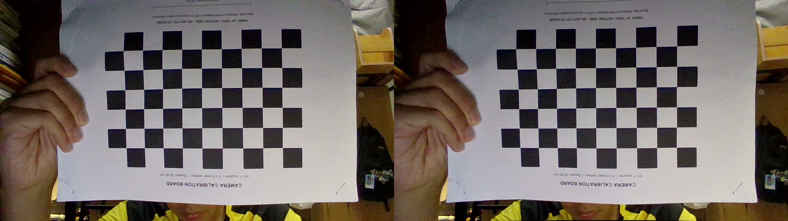
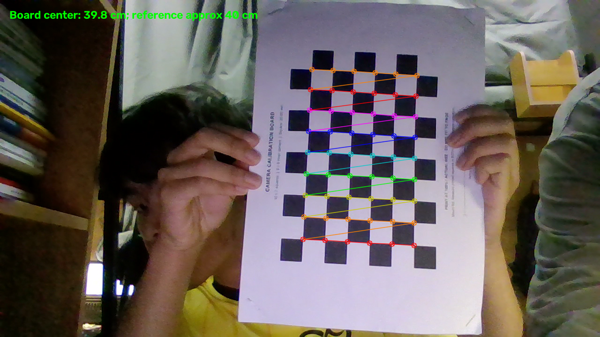

# MountainForge 视觉组招新考核：最终提交材料

答辩入口：[12分钟讲解提纲与参考问答](DEFENSE_OUTLINE.md)，覆盖实现思路、实验结果、不足和常见追问。

## 1. 完成情况一览

| 部分 | 已有内容 | 未完成或限制 | 详细报告 |
|---|---|---|---|
| 公共题一 | Windows Python环境、依赖检查、本地目录组织与Git初始化 | GitHub最终版已上传；无开发期间持续提交记录，问卷链接未确认；无Linux验证截图 | [题一答题](q1_env/答题.md) |
| 公共题二 | 24张标定原图、内参和畸变、重投影误差、去畸变图、40cm单点粗测对比 | 格长未实测；单点使用棋盘内角点，不是A4四外角；没有五组距离、角度和其他对比实测 | [题二答题](q2_calib/答题.md) |
| A题基本要求 | 两段必做视频识别/位姿、平移预测、曲线、调参工具及截图 | 无独立位置真值，侧视/遮挡仍有限制 | [A题提交报告](qA_aim/SUBMISSION_REPORT.md) |
| A题发挥部分 | 已有近距离及蓝色视频结果、同视频Q/R对比 | 小陀螺车体中心、角速度及对应曲线未完成 | 同上 |
| B题基本要求 | 点云处理、栅格生成、手写A*/Dijkstra及七组查询结论 | 第6组净空不足、第7组越界，按要求说明无法到达 | [B题最终报告](qB_sentry/FINAL_REPORT.md) |
| B题发挥部分 | 地形规则、异常外壳处理、对正配准、搜索可视化、自建图规划、决策仿真及融合优化 | 配准朝向歧义；插值依赖模型；第3组仅18/27局部扰动整路通过；无实车验证 | 同上 |
| 附加题 | MNIST替代实验、架构比较、评价局限、ROS 2简介 | 一为替代实验，三非完整作答；二、四已有文档 | [附加题报告](extra/REPORT.md) |

逐项核对及优先级见 [提交缺项清单](SUBMISSION_CHECKLIST.md)。考生此前反馈已与出题方沟通，题二暂按40cm粗测单点整理；这属于用户提供的沟通背景，本地没有独立确认材料，不能据此将原题书面要求标为全部完成。

## 2. 公共题方案与结果

### 题一：环境与工程规范

使用项目独立虚拟环境，当前Python 3.13.11；直接依赖清单分题保存。2026-10-19重新核对环境版本，NumPy、OpenCV、Matplotlib、PyYAML、ReportLab、Open3D及SciPy均有已安装版本，pip check无依赖冲突，见 [最终环境记录](q1_env/environment_final_check.json)。这只验证环境与依赖，不代表在本次整理中重跑了实验。

2026-10-20已在D:\RM1初始化Git仓库，准备最终版提交；远端仓库已建立：[rm-vision-recruit-LiChenyang](https://github.com/li15258288146-create/rm-vision-recruit-LiChenyang)（公开），最终版已推送至main，含答辩提纲、附加题报告、MNIST代码、数据和模型。已核对远端512个文件与本地Git内容哈希一致；仓库已公开，评审可直接访问。此次初始化不代表开发期间已有持续提交历史，不补造过去记录。

### 题二：标定与单点粗测

采用9×6内角点、设计格长20mm的打印棋盘板。最终标定使用24张1280×720图像；总体重投影RMS为1.356613px。内参fx=909.794493、fy=909.798633、cx=656.699804、cy=392.309050。完整畸变参数及逐图外参见 [camera.json](q2_calib/results/retake_check/calibration/camera.json)。旧results/camera.json不作为当前结果。

单点记录使用54个棋盘内角点，估计棋盘中心距离0.397650m，与用户提供的约0.40m粗测值相差约2.35mm、相对差异约0.59%。格长未尺测、参考基准未核实，计算小数不能解释成毫米级真实精度，也不能替代五组0.5～3m的A4外角测距。完整记录见 [单点JSON](q2_calib/results/quick_check_40cm/result.json)。

fx/fy是像素焦距，cx/cy是主点；fx与fy接近与像素比例等因素相符，但不是标定正确的充分条件。重投影误差衡量当前像素观测的拟合，不等于距离真值误差。详细问题回答及误差分析在题二答题中。

## 3. A题已有实验汇总

本节仅摘录保存结果，运行说明与代码目录见 [A题运行说明](qA_aim/RUN_GUIDE.md)。

| 视频 | 总帧数 | 有检测帧数 | 输出行数 | PnP残差中位数px |
|---|---:|---:|---:|---:|
| 远距离平移 | 1546 | 1546 | 1546 | 0.248 |
| 中距离陀螺 | 2550 | 2550 | 3260 | 0.567 |
| 近距离陀螺 | 2105 | 2105 | 2648 | 0.726 |
| 装甲板_蓝 | 1684 | 1209 | 1218 | 不适用 |

近距离和蓝色为前次结果；基本题两段视频已有完整解码复核记录。检测帧覆盖率不是精确率或召回率。蓝色没有对应内参，位姿列留空。

平移预测共有1546个输出时刻、1508个有效未来比较时刻；平均三维差值0.2448m，静止基线0.4723m。x/y/z的RMSE为0.2991/0.0171/0.0956m。总体改善主要来自x方向，y/z比静止基线更差，不能称各方向均改善。比较对象为未来PnP观测，无独立真值；同视频选择参数不构成独立泛化验证。

**小陀螺车体中心和角速度未实现，没有对应pred文件或曲线。** 单块装甲板位姿不能替代这部分结果。问题回答、误差来源及限制见A题提交报告；此前保存的6项测试与产物复核记录见 [basic_validation.json](qA_aim/basic_validation.json)。

## 4. B题已有实验汇总

点云预处理、调平、局部支撑面建图与手写网格搜索的完整方案见B题最终报告；本节突出三种不同实验，避免混用文件。

| 查询 | 给定图基本题路径m | 独立自建图路径m | 最新融合路径m |
|---|---:|---:|---:|
| 1 | 21.077 | 20.548 | 22.902 |
| 2 | 27.493 | 31.178 | 34.028 |
| 3 | 50.832 | 54.933 | 60.990 |
| 4 | 25.883 | 28.103 | 31.323 |
| 5 | 56.959 | 59.547 | 66.106 |
| 6 | 终点净空不足 | 终点净空不足 | 终点净空不足 |
| 7 | 终点越界 | 终点越界 | 终点越界 |

- 基本题主提交为qB_sentry/path1.csv～path5.csv，对应给定图；没有第6/7组路径是正确失败结论，不是漏交。
- 独立自建图的10条路径在自建图通过，但交叉到给定图有碰撞；原失败日志保留。
- 最新融合路径在给定、自建、融合三图共30次检查通过；融合显式使用两图约束，不能称纯点云建图精度提升。

配准有近似180°朝向歧义，结构留出轮廓残差中位数约0.199m。27种局部平移/旋转扰动中第1、2、4、5组整条路径均通过；第3组仅18/27通过，余下9种原始起点本身净空不足。没有修改端点或0.30m半径，也不能把离散测试当连续误差范围安全保证。

已有简化决策仿真覆盖六状态、九次切换，240s内2401次运动/位置检查零碰撞；这是给定静态地图上的仿真，不是实车或完整比赛验证。已有24项测试和55次提交路径核查记录，见 [验证记录](qB_sentry/results/submission_verification.json)。本次整理未重跑这些实验。

## 5. 运行与材料索引

| 部分 | 运行/代码说明 | 原始与结果材料 |
|---|---|---|
| 公共题 | [公共题索引](公共题答题.md)、[题二操作说明](q2_calib/README.md) | q2_calib/images/、board/、results/ |
| A题 | [运行说明](qA_aim/RUN_GUIDE.md)、[提交报告](qA_aim/SUBMISSION_REPORT.md) | data/armor/、qA_aim/*.csv、figures/ |
| B题 | [运行说明](qB_sentry/RUN_GUIDE.md)、[代码导读](qB_sentry/DEFENSE_GUIDE.md) | data/map/、data/rmuc_2025_map.pcd、qB_sentry/results/ |
| 附加题 | [答题与实验报告](extra/REPORT.md)、[MNIST运行说明](extra/mnist/README.md) | extra/mnist/data/、runs/20261020_183707/ |
| 总体核对 | [缺项清单](SUBMISSION_CHECKLIST.md)、[本次材料审计](submission_audit.json) | 仅检查文件与文档，不等于重做实验 |

保留data、tools和题目目录的相对位置。不同题目的依赖和历史结果不互相替换；虚拟环境、缓存和旧提交ZIP不纳入新包。2026-10-20重新打包的全套提交包含extra报告、MNIST代码、原始数据、模型及实验记录；2026-10-19全套包与更早的B题包保留为历史快照。具体文件清单以新包内PACKAGE_MANIFEST.json为准。

新增MNIST实验：测试集准确率98.06%，两引擎类别一致率100%；CPU单线程batch1平均耗时PyTorch 0.11667ms、ORT 0.01817ms（约6.42倍），batch32约7.43倍。数值仅适用本机与报告中的微基准条件，不是装甲板识别结果。训练、ONNX结构检查、全测试集数值比较和原始计时重算均有保存证据。

## 6. 问题记录与学习总结

已遇到并记录：标定板起伏、未实测尺度、旧相机参数路径误用；A题评估无有效样本时的NaN、时间对齐与指标含义；B题额外膨胀、未知灰度205被误当空闲、独立图和给定图边界差异。这些问题及发现方式汇总为 [五个关键AI交互](ai_log.md)。

从已有工作可提炼的技术认识是：输入尺度、坐标约定和数据质量与算法本身同样重要；拟合一致性和真实精度需要区分；失败结果、未知区域及固定端点限制应明确报告；实验可复现不仅需要源码，也需要数据、参数、依赖和输出证据。
