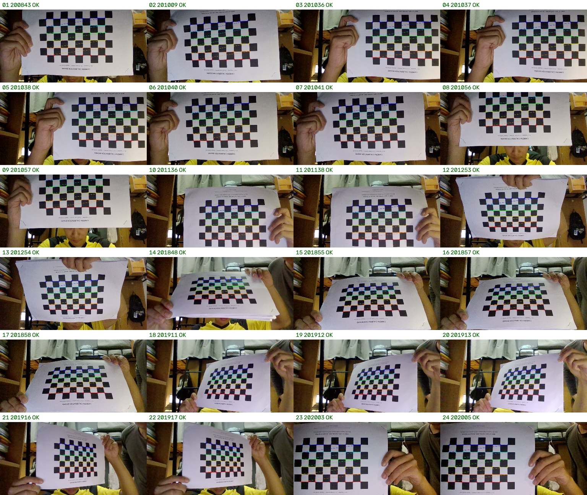
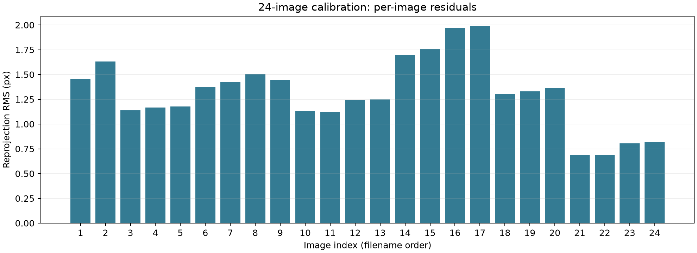

# 题二 相机标定与单目测距

## 实验目标与本次范围

本实验使用摄像头采集棋盘格图像，通过 OpenCV 求解相机内参和畸变系数，再利用已知尺寸平面目标的三维点与像素点对应关系，使用 PnP 估计目标距离。

本次报告采用 24 张图像的标定结果，以及测距仪粗测 40 cm 的单点对比。测距目标为打印在 A4 纸上的棋盘格，实际使用 54 个内角点，未使用 A4 外边缘四角。按考生与出题方沟通后的安排，当前不补采多距离实验；以下如实记录现有方法、数据与误差，不将单点结果扩展为多距离性能结论。

## 标定板与数据采集

标定板采用 A4 横向 PDF，10 列×7 行黑白方格，对应 9 列×6 行内角点，设计方格边长为 20 mm。按考生说明采用原尺寸打印，但未用尺实测，故本次物理尺度使用设计值。

使用 `capture.py` 保存 1280×720 原始图像，在画面中心、上下左右位置及不同倾斜姿态采集。初次采集存在纸面弯曲，之后重新固定并补拍；对存在明显起伏或棋盘外缘截断的照片进行备份移出。最终保留 24 张，每张均成功检测到 54 个内角点。



图 1：最终图像集的角点检测结果。图像中仍有部分重复姿态和纸面起伏，这是本次实验的质量限制。

## 标定算法

首先使用 `findChessboardCorners` 检测内角点，然后用 `cornerSubPix` 进行亚像素细化。将棋盘格设在目标坐标系的 Z=0 平面，构造真实坐标：

\[
P_{ij}=(0.020i,\;0.020j,\;0)^T
\]

其中长度单位为米。将每张图中的二维角点与对应三维点输入 `calibrateCamera`，联合估计相机内参、畸变系数和各视图外参。用 `projectPoints` 将三维点重新投影到图像，计算逐图误差。

核心流程：

```text
原始图像 → 棋盘格角点检测 → 亚像素细化
→ 2D/3D 对应 → 相机标定 → 重投影检查 → 去畸变
```

复现命令：

```powershell
.\.venv\Scripts\python.exe q2_calib/calibrate.py --square-mm 20 --out q2_calib/results/retake_check/calibration
```

## 标定结果

内参矩阵（焦距及主点坐标单位为像素）：

\[
K=\begin{bmatrix}
909.794493 & 0 & 656.699804\\
0 & 909.798633 & 392.309050\\
0 & 0 & 1
\end{bmatrix}
\]

畸变系数按 `(k1, k2, p1, p2, k3)` 排列：

```text
[-0.01882207, -0.34839301, 0.01498500, 0.00134661, 0.34056010]
```

| 指标 | 结果 |
|---|---:|
| 图像尺寸 | 1280×720 px |
| 有效图像 | 24 张 |
| 每张角点 | 54 个 |
| 总体重投影 RMS | 1.356613 px |
| 逐图 RMS 最小值 | 0.682939 px |
| 逐图 RMS 最大值 | 1.991156 px |



图 2：24 张标定图的重投影 RMS，序号按文件名排序。

此前 22 张图标定的总体 RMS 为 1.979827 px，筛选并补拍后为 1.356613 px。两者的数据集不同，这说明当前拟合残差有所改善，但不构成独立测试精度提升的证明。


图 3：左侧原图，右侧使用当前内参与畸变参数校正后的图像。去畸变只能校正相机模型描述的镜头畸变，不能修复标定板本身的弯曲。

完整参数见 [camera.json](results/retake_check/calibration/camera.json)，逐图数据见 [reprojection_errors.csv](results/retake_check/calibration/reprojection_errors.csv)。

## 40 cm 单点测距

### 实际方法

测距图像为 `20261018_203840_129832.png`。A4 纸四个外角没有全部清楚入镜，因此使用图中完整可见的棋盘格内角点。棋盘在该图中竖向摆放，检测尺寸为 6 列×9 行内角点；真实格长仍按 0.020 m。

将目标坐标原点设置在棋盘中心，输入原始像素坐标、当前相机内参与畸变系数，调用 `solvePnP`。PnP 返回的平移向量为：

\[
t=(0.049472,\;-0.026872,\;0.393645)^T\ \text{m}
\]

相机坐标系 x 向右、y 向下、z 向前。这里 z 是光轴深度，空间距离取平移向量的模长：

\[
d=\sqrt{t_x^2+t_y^2+t_z^2}=0.397650\ \text{m}
\]

### 测距结果与误差

测距仪粗测参考值由本人提供，为约 0.40 m。

| 项目 | 结果 |
|---|---:|
| 粗测参考距离 | 约 40 cm |
| PnP 棋盘中心距离 | 39.765 cm，约 39.8 cm |
| 光轴方向深度 | 39.364 cm |
| 有符号差值（估计－参考） | −0.235 cm |
| 绝对差值 | 0.235 cm，约 2.35 mm |
| 相对差异 | 0.587%，约 0.59% |
| 本图 PnP 重投影 RMS | 0.789417 px |

计算公式为：

\[
e=|d-d_{ref}|,
\qquad e_r=\frac{|d-d_{ref}|}{d_{ref}}\times100\%
\]


图 4：40 cm 粗测场景中的棋盘格角点及估计距离。

结果表明，本场景下的几何测距结果与 40 cm 粗测读数接近。参考读数未确定不确定度，仪器基准与相机光心的位置关系也未核实，因此不能把 2.35 mm 差值解释为系统达到了毫米级精度。按打印板设计，棋盘中心与纸张中心相差 5 mm，也需考虑参考目标位置是否一致。计算保留的小数位仅便于复算。

详细记录见 [result.json](results/quick_check_40cm/result.json) 和 [experiment_record.csv](results/quick_check_40cm/experiment_record.csv)。仅有一个距离数据点，不绘制或推断误差随距离变化的曲线。

## 问题回答

### 内参各参数的物理含义以及 fx 与 fy 接近的原因

`fx`、`fy` 为像素单位的水平、垂直焦距；`cx`、`cy` 为主点坐标，即光轴与理想成像平面交点在图像中的位置。矩阵中非对角项按无倾斜像素轴模型取零，最后一行为齐次坐标表达。

对于同一个镜头，如果像素横纵尺寸近似相同且图像未发生非等比例缩放，那么同一物理焦距换算得到的 `fx` 与 `fy` 应接近。本实验两者约为 909.8 px。它们接近是合理现象，但不是标定正确的充分条件；主点也不必恰好位于图像几何中心。

### 重投影误差衡量什么

它衡量实际检测到的角点与通过标定模型重新投影得到的角点之间的像素差异。本程序使用：

\[
\mathrm{RMS}=\sqrt{\frac{1}{N}\sum_{i=1}^{N}
[(u_i-\hat u_i)^2+(v_i-\hat v_i)^2]}
\]

单位为 px。误差小表示模型对当前角点数据拟合较好，但错误尺度、标定板弯曲或视角不足仍可能影响实际测距。它与单位为 m 的距离误差不能直接等同。

## 误差来源与改进

1. **板面不平整**：模型假定所有角点共面，纸张弯曲会破坏该假设。应将整张纸贴紧刚性平板，手持时避免让板弯曲。
2. **角点定位噪声**：暗光、模糊和图像噪声会影响角点定位。应增加均匀照明、停稳拍照，并采用亚像素细化。
3. **物理尺寸未核实**：当前用设计格长 20 mm，打印缩放会影响棋盘格 PnP 的距离尺度。应横纵测量连续多格确认尺寸。
4. **参考测量基准**：测距仪起算位置、相机光心以及纸面瞄准位置可能不同。应固定测量基准并记录读数和目标位置。
5. **相机与样本条件**：自动对焦、裁剪、缩放，以及重复姿态较多都会影响参数适用性或约束强度。应固定相机模式并增加有差异的有效视角。

## 发挥部分的理论分析

以下为原因分析，本次未开展对应对比实验。

- **倾斜角增大**：目标在图像中的某一方向被压缩，角点定位误差相对影响可能增大；不代表所有场景中误差都随角度单调增加。
- **只用五张图**：视角覆盖与冗余减少，参数更易受单张噪声影响，但结果还取决于这五张图的姿态多样性。
- **全部正对标定板**：视角约束不足，某些参数难以稳定分离，即使训练重投影误差低，也不一定具有可靠的独立测距表现。
- **方格尺寸统一输错**：在理想标定模型下，统一缩放物点坐标主要缩放标定外参，不要求内参同比变化。若随后使用正确尺寸的独立 A4 目标做 PnP，距离不会必然同比出错；若继续使用错误格长的棋盘格做 PnP，则估计距离会随物点尺度改变。本次单点测距属于后者，因此打印格长值得核实。

## 问题记录与学习总结

实验中，最初把“检测出全部角点”视为照片可用的重要依据，但进一步检查发现纸面弯曲会使标定误差变大。之后结合原图、角点覆盖和逐图重投影误差筛选，保留原始备份并补拍。由此认识到，检测成功仅是算法输入条件，不能代替物理模型和数据质量检查。

另一个问题是新版标定结果与旧版参数保存在不同位置，测距程序最初默认指向旧结果。现已将默认路径改为当前 24 张图的参数目录，避免使用不一致的参数。

本次理解了从像素坐标到实际位置的完整流程，也认识到单目测距依赖真实尺寸、相机参数和正确点对应。现有单点数据支持基本流程验证；多距离精度、角度影响与重复测量稳定性未在本次实验中验证。
