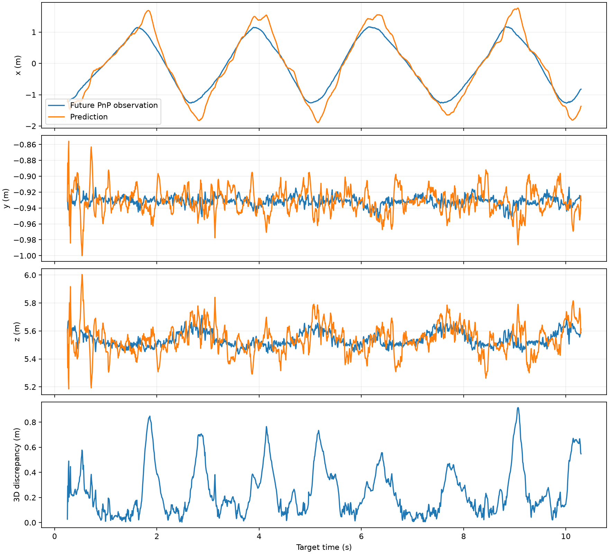
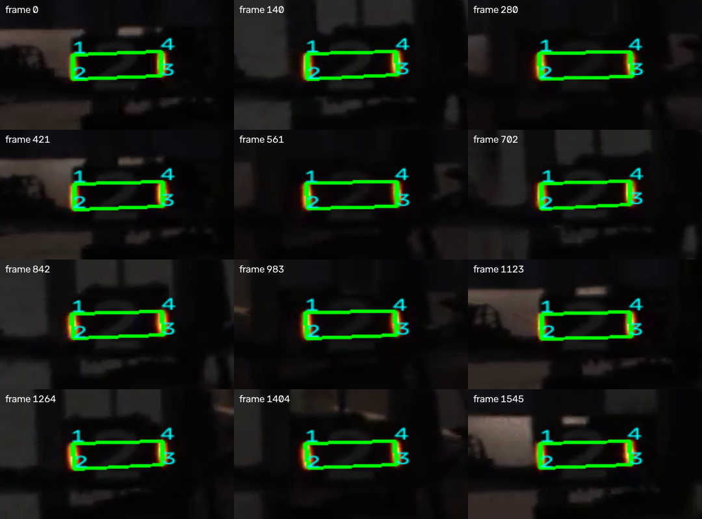
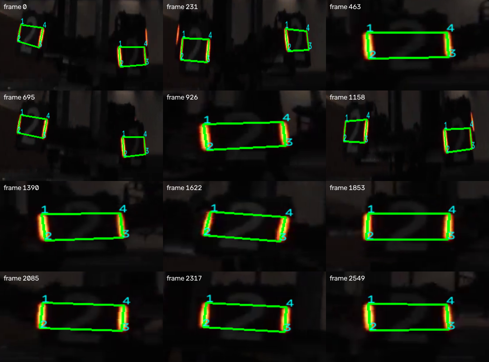

# A题基本要求完成报告（2026-10-19）

## 本轮检查与完成范围

现有工程已有检测、PnP、匀速卡尔曼和四段视频结果。本轮聚焦两段必做红色视频，检查源码及素材并重新生成基本题产物；保留近距离陀螺、蓝色识别及Q/R实验旧结果，未把它们当作本轮新增完成项。小陀螺中心和角速度估计仍未实现。

| 基本要求 | 实现与文件 | 结果 |
|---|---|---|
| 两段视频逐帧识别与四点输出 | aim.py、detections_远距离平移.csv、detections_中距离陀螺.csv | 点序左上、左下、右下、右上；CSV对应1440×1080原图 |
| PnP位置与yaw | 小装甲板135×55 mm，提供的K和畸变，IPPE候选筛选 | x右、y下、z前，位置m、yaw rad |
| 平移位置曲线与俯视轨迹 | figures/translation_timeseries.png、translation_xz.png | 观测与滤波曲线，x-z轨迹 |
| 0.25秒预测及比较 | pred_远距离平移.csv、prediction_evaluation.csv、figures/prediction_error.png | 三轴预测/未来观测比较和三维差值统计 |
| 滑动条阈值工具与截图 | tune_threshold.py、figures/threshold_tool_window.jpg | 已有真实窗口截图经检查；亮度/颜色差调节，Space暂停、S保存、Q退出 |

## 方案和修补

颜色差与亮度分割→灯条PCA端点→长度/方向/间距配对→135×55 mm平面PnP→正深度与4px重投影筛选。每根灯条只使用一次，拒绝跨越中间灯条。IPPE选择正深度且残差最小的候选，但侧视、模糊、遮挡及平面双解仍可能造成误差。yaw定义为对象+Z法向在相机x-z平面的角度 atan2(R[0,2],R[2,2])。

匀速KF状态[x,y,z,vx,vy,vz]，dt=1/150s，仅使用当前及历史观测更新，再外推0.25s。Q=qGGᵀ（q=300）、R=0.001I；马氏距离门控抑制离群点，长期缺失重置。0.25s是37.5帧，评估对第n+37与n+38帧观测取平均，末尾无参照的预测不参与误差统计。未来观测仅用于离线评价，不回灌滤波。

本轮修改：

- run_aim.py新增--brightness、--difference、--settings，调参保存的JSON可用于批处理；显式参数优先于JSON，默认140/60。
- 运行前检查视频文件、解码和相机分辨率，避免以不匹配内参静默运行。
- 空评估样本返回null，不产生NaN统计；有样本时原有数值不变。
- 原先仅显示未来x轴对比，现补齐x/y/z，并导出逐帧发布时刻、目标时刻、预测、未来观测及误差。
- 阈值工具增加视频打开失败处理和窗口关闭退出。
- 新增滤波因果性、37.5帧时间对齐、离群/缺失恢复及空样本测试；增加可重复执行的基本题产物核查。

## 本次实际结果

| 视频 | 完整输入帧数 | 至少一块检测的帧数 | 装甲板输出行数 | PnP残差中位数 |
|---|---:|---:|---:|---:|
| 远距离平移 | 1546 | 1546 | 1546 | 0.248 px |
| 中距离陀螺 | 2550 | 2550 | 3260 | 0.567 px |

这只是检测覆盖统计，没有人工逐帧标签，不能称准确率或召回率100%。中距离侧视板仍有漏检风险；低重投影误差也不等于位姿真值误差小。

| 预测方法 | 三维差值均值 m | 中位数 m | x/y/z RMSE m |
|---|---:|---:|---|
| 匀速KF，1508个有效比较时刻 | 0.2448 | 0.1802 | 0.2991 / 0.0171 / 0.0956 |
| 保持当前位置基线 | 0.4723 | 0.4937 | 0.5055 / 0.0084 / 0.0554 |

预测CSV共1546行，t是发布时刻，预测针对t+0.25s。匀速模型改善主运动x方向，y/z噪声外推和换向时的加速度使误差增大。这是相对于未来PnP观测的一致性，无独立位置真值，不能表述为实车瞄准误差。Q/R在同一视频上选择，也不是隐藏视频性能保证。







## 复现和调参

在D:\RM1或完整项目根目录执行，无需启动摄像头，输入是题目视频：

```powershell
.\.venv\Scripts\python.exe -m pip install -r qA_aim/requirements.txt
.\.venv\Scripts\python.exe -m unittest discover -s qA_aim -p "test_*.py"
.\.venv\Scripts\python.exe qA_aim/run_aim.py --videos 远距离平移 中距离陀螺
.\.venv\Scripts\python.exe qA_aim/verify_basic.py
```

阈值工具：

```powershell
.\.venv\Scripts\python.exe qA_aim/tune_threshold.py
```

Space暂停在当前帧，拖动Brightness和Color difference查看掩码与框选；S保存figures/threshold_settings.json和处理面板，Q退出。S保存的面板不含系统滑动条，已有threshold_tool_window.jpg为此前完整窗口截图，本轮检查了图像，未重新执行鼠标滑动操作。

保存后批处理：

```powershell
.\.venv\Scripts\python.exe qA_aim/run_aim.py --videos 远距离平移 中距离陀螺 --settings qA_aim/figures/threshold_settings.json
```

或直接传 `--brightness 140 --difference 60`。重新调参会更新结果和统计，报告中的数字为本次默认阈值实验。

## 验证与阅读入口

6项测试通过，涵盖合成灯条点序、米制PnP、KF因果性、时间对齐、离群/缺失恢复和空样本。verify_basic.py完整解码两段源视频及输出视频，核对CSV列/点序/坐标范围/正深度，抽样复算PnP，复算预测表和RMSE并检查图像可读。机器可读证据见 [basic_validation.json](basic_validation.json)。近景抽查图是自动选取的12个时刻，不能替代全帧人工标注。

完整算法解释和题目问题回答见 [README.md](README.md)。两个全长识别视频位于figures/远距离平移_detections.mp4与中距离陀螺_detections.mp4；输出720×540，150fps，CSV仍为原始分辨率坐标。本轮不涉及B题修改。
