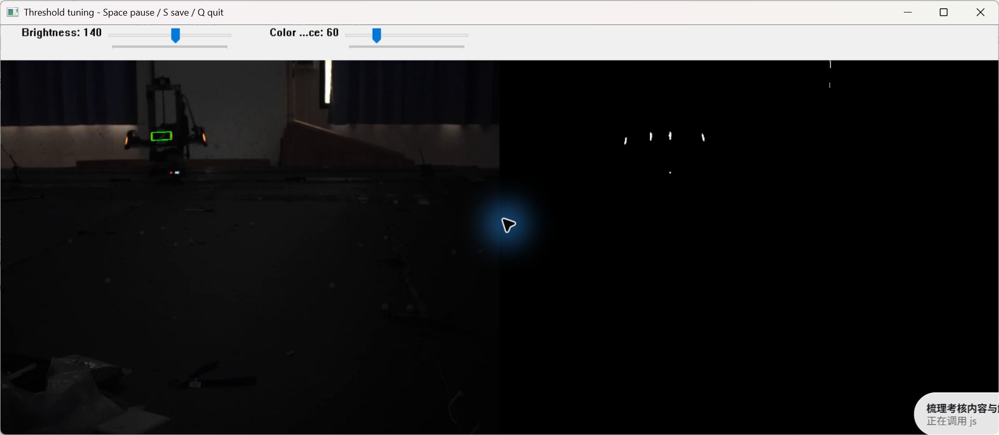
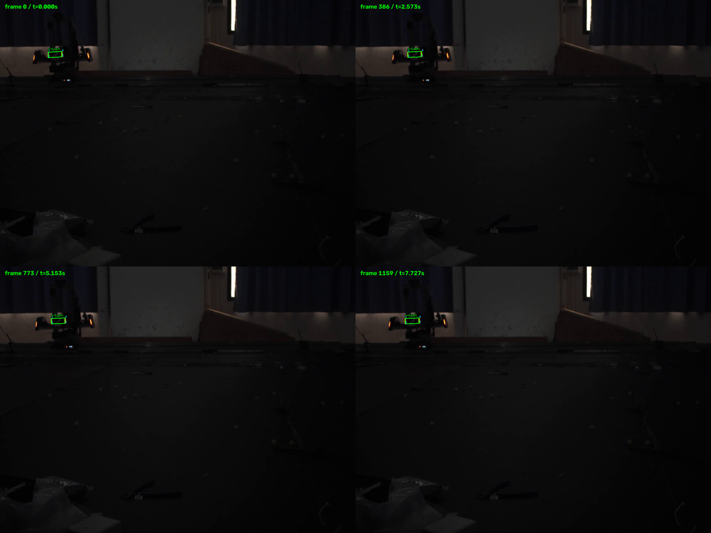
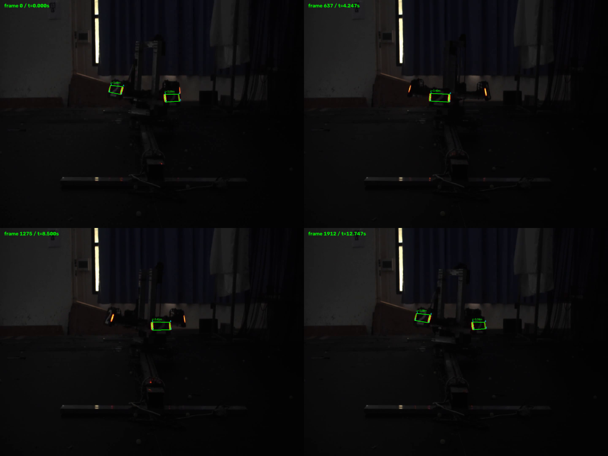
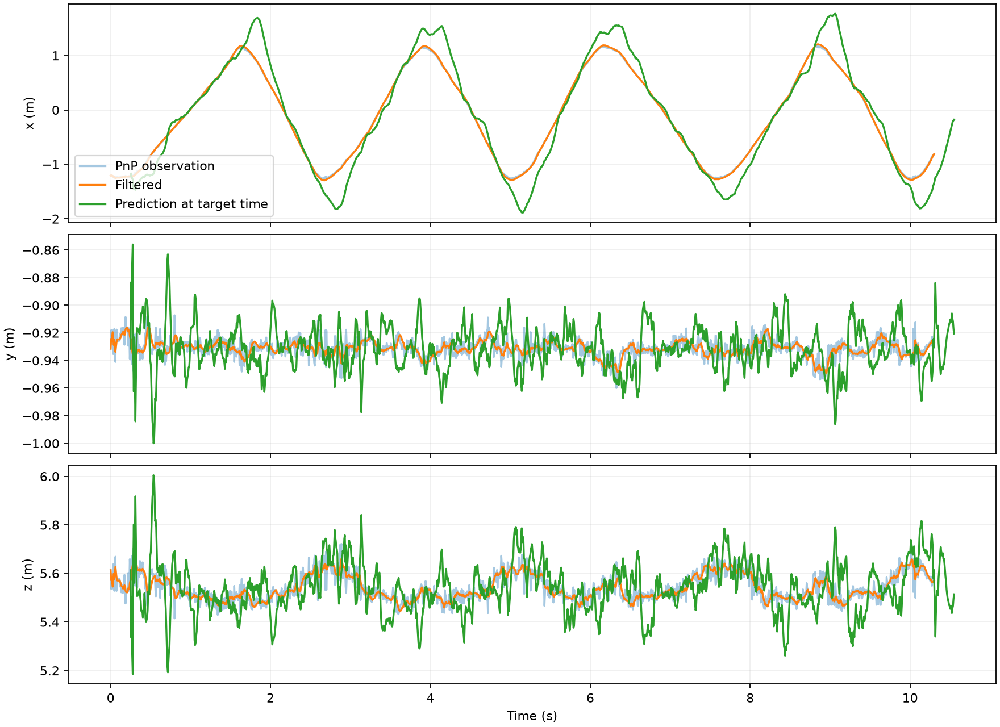
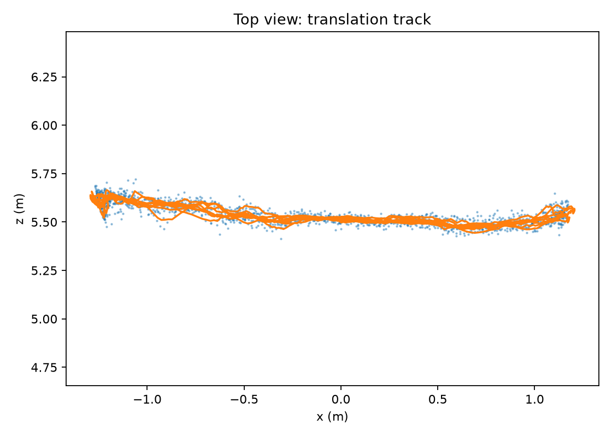
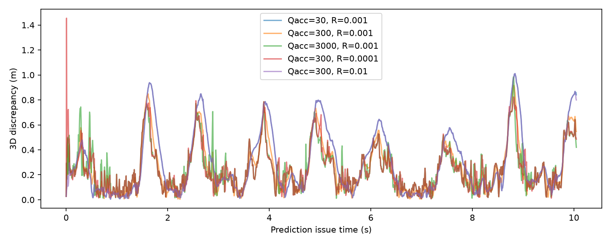

# A 题 装甲板识别与运动预测

> **提交阅读入口：** [已完成内容提交报告](SUBMISSION_REPORT.md) · [已有程序运行说明](RUN_GUIDE.md)。报告汇总基本题和已有部分发挥结果；小陀螺车体中心、角速度及对应曲线未完成。以下保留阶段说明。

> **2026-10-19 基本题复核：** 两段必做视频已重新运行，补齐阈值参数接口、三轴未来比较、逐帧误差表及验证。最新运行与结果见 [BASIC_REPORT.md](BASIC_REPORT.md)，核查入口为 `verify_basic.py`。近距离和蓝色结果属于此前额外实验，本轮未重新运行。

## 完成范围与运行

已逐帧运行四段视频，输出关键点 CSV、红色目标位姿、识别视频、平移轨迹、0.25 s 预测和 Q/R 对比。蓝色视频不使用其他视频的内参，位姿列留空。小陀螺车体中心及角速度估计尚未实现，当前实现是基础方案，不声称完成全部发挥部分。

在仓库根目录运行：

```powershell
.\.venv\Scripts\python.exe qA_aim/test_aim.py
.\.venv\Scripts\python.exe qA_aim/run_aim.py
.\.venv\Scripts\python.exe qA_aim/tune_threshold.py
```

依赖为 numpy、opencv-python、matplotlib，使用当前项目虚拟环境。`--videos 远距离平移` 可仅重新处理指定视频。调参窗口滑动条控制亮度及颜色差阈值；Space 暂停，S 保存处理画面和参数，Q 退出。下图是真实窗口截图，包含滑动条。



## 识别与位姿

流程：颜色差与亮度阈值 → 连通轮廓 → PCA 灯条方向与端点 → 几何配对 → 四点 IPPE PnP → 重投影与深度筛选。

红色使用 R−B>60 且 R>140，蓝色对调通道。灯条要求面积、长度、细长程度与竖直倾角合格；配对约束归一化横向间隔、纵向错位、长度比和方向差，优先使用几何代价较小的组合。灯条间若有同高度中间灯条则拒绝跨越配对，每根灯条最多使用一次。这是可解释的贪心几何方法，不能保证任意遮挡和侧视情况下正确。

关键点顺序固定为左上、左下、右下、右上。模型点位于 z=0 平面，横向 ±0.0675 m、纵向 ±0.0275 m。直接使用题目提供内参和畸变系数；对 IPPE 候选选正深度且重投影残差最小的解。残差超过 4 px 或 z 不在 0.2～30 m 时拒绝。x 向右、y 向下、z 向前，单位 m；yaw=atan2(R[0,2],R[2,2])，单位 rad，定义为对象 +Z 法向在相机 x–z 平面中的角度，正对时约为零。

| 视频 | 总帧数 | 有检测的帧数 | 输出装甲板行数 | PnP 残差中位数 px |
|---|---:|---:|---:|---:|
| 远距离平移 | 1546 | 1546 | 1546 | 0.248 |
| 中距离陀螺 | 2550 | 2550 | 3260 | 0.567 |
| 近距离陀螺 | 2105 | 2105 | 2648 | 0.726 |
| 装甲板_蓝 | 1684 | 1209 | 1218 | — |

“有检测的帧”仅指该帧至少检出一块，不能据此宣称所有装甲板都被检出或准确率 100%。侧视投影过窄的装甲板存在漏检；蓝色视频遮挡时也有缺失。当前没有人工逐帧标签，未计算准确率或召回率。




## 状态估计与未来预测

状态为 [x,y,z,vx,vy,vz]，采用匀速线性模型，dt=1/150 s。F 的位置—速度块为 dt·I，H 取前三个位置分量；Q=qGGᵀ，G=[dt²/2·I; dt·I]，R=rI。当前 q=300，r=0.001。先预测，再使用当前观测更新，未来预测为 p(t)+0.25v(t)，没有使用未来观测更新当前状态。

平移视频通过相邻位置最近关联选定目标，单帧跳变超过 0.6 m 暂停接收；滤波中再使用马氏距离平方小于 25 的门控。持续丢失超过 75 帧重置。当前平移视频 1546 个观测均通过最终滤波门控。

0.25 s 等于 37.5 帧，评估时对第 n+37、n+38 帧观测取平均，作为 t+0.25 s 的比较值。末尾 38 帧没有完整未来参照，不计入误差，但仍输出预测。共评估 1508 帧。

| 方法 | 三维差值均值 m | 中位数 m | x/y/z 分量 RMSE m |
|---|---:|---:|---|
| 匀速卡尔曼预测 | 0.2448 | 0.1802 | 0.2991 / 0.0171 / 0.0956 |
| 保持当前位置不动 | 0.4723 | 0.4937 | 0.5055 / 0.0084 / 0.0554 |

预测在主运动方向 x 上有改善，但 y、z 上速度外推会放大观测抖动，换向处的匀速假设也失效。这里衡量的是相对未来 PnP 观测的一致性，不是相对独立真实位置的绝对精度。





## Q、R 对比

| q | r | 三维差值均值 m |
|---:|---:|---:|
| 30 | 0.001 | 0.2913 |
| 300 | 0.001 | 0.2448 |
| 3000 | 0.001 | 0.2454 |
| 300 | 0.0001 | 0.2453 |
| 300 | 0.01 | 0.2901 |

较大的 Q 允许速度更快调整，减少换向迟滞，同时放大速度噪声。较大的 R 更信任模型，轨迹更平滑但跟随较慢。参数在同一视频上比较和选择，没有独立验证集，以上结果不是未知视频性能保证。



## 必答问题

1. **步骤依据**：敌方颜色与发光亮度先排背景；细长形状与方向找灯条；两灯条几何关系组成装甲板；真实尺寸与内参恢复尺度；时序模型估计速度并预测。
2. **误检来源**：背景指示灯、反光、车体亮色边缘。颜色、面积、细长比、倾角和成对结构共同筛选；仅靠颜色无法排除所有干扰。
3. **相邻装甲板错误配对**：禁止跨越中间灯条，比较长度和角度，按代价选择不复用灯条的配对。强透视和遮挡仍可能误配，后续可加入装甲板外观分类和多帧身份关联。
4. **是否使用畸变系数**：每 15 帧对相同关键点分别解算，三维位置差中位数/最大值为：平移 6.70/17.14 mm，中距离 1.69/3.11 mm，近距离 0.72/2.66 mm。中、近距离样本按到主点距离二分，外半组差值更大；平移样本反而内半组中位数较大。因此不能从混合姿态样本推断 PnP 差值必随像素半径单调增加。像面径向畸变通常随半径变化，位姿差还受姿态、深度及解的条件数影响，当前采样也未覆盖整幅图像最边缘。
5. **关键点顺序错误**：物体点与像素点对应错误，可产生翻转姿态、错误朝向或高重投影残差；某些对称置换仍可能得到小残差，因此必须在构造数据时固定顺序，不能只靠残差检查。
6. **噪声与异常**：曝光、像素量化、运动模糊引起端点抖动；平面 PnP 双解和侧视导致深度/朝向不稳；遮挡引起漏检。用几何筛选、正深度和残差筛选、时序关联及门控处理。仍保留了换向预测误差，不人为平滑评估结果。
7. **小陀螺模型**：装甲板围绕中心周期运动，匀速直线模型不适合直接描述，应使用中心、半径、相位、角速度的非线性观测模型与 EKF 等方法。本次尚未实现中心/角速度估计，因此不填未经计算的转速。

## 文件与验证

- `aim.py`：检测、PnP、卡尔曼核心。
- `run_aim.py`：批处理、CSV、视频和误差图。
- `detections_<视频名>.csv`：四段视频关键点与位姿。
- `pred_远距离平移.csv`：t 为发布时刻，坐标为 t+0.25 s 的预测。
- `figures/<视频名>_detections.mp4`：全长识别视频，输出 720×540，CSV 坐标仍对应原图；帧率保留 150/24 fps。
- `metrics.json`、`qr_metrics.json`：实际统计结果；`distortion_comparison_*.csv`：畸变对比样本。

使用合成灯条检测及已知位姿投影反解测试检查配对、关键点顺序与米制尺度；四段视频完整处理成功。下一步重点是侧视漏检、多目标关联及小陀螺模型，不将当前几何基线描述为成熟实车自瞄系统。
