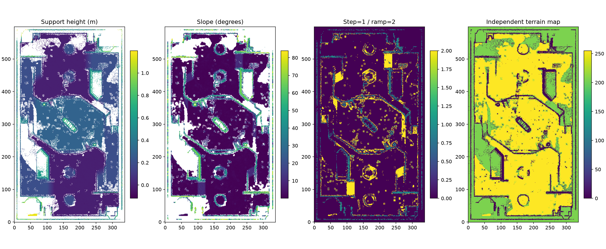
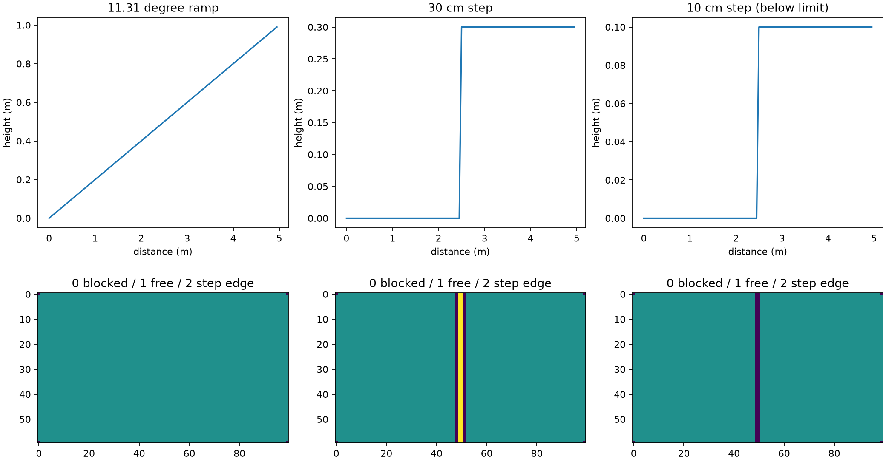
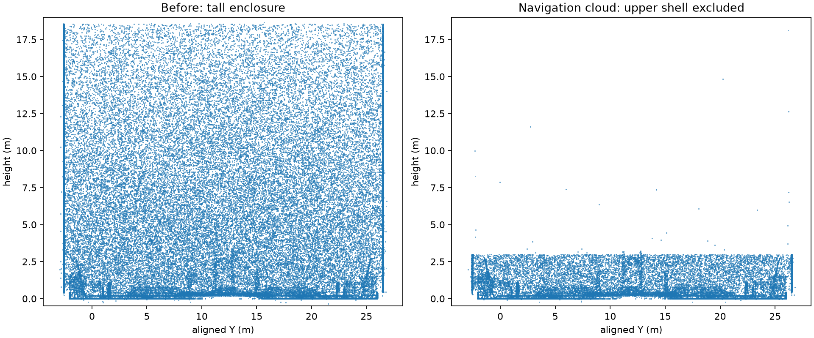
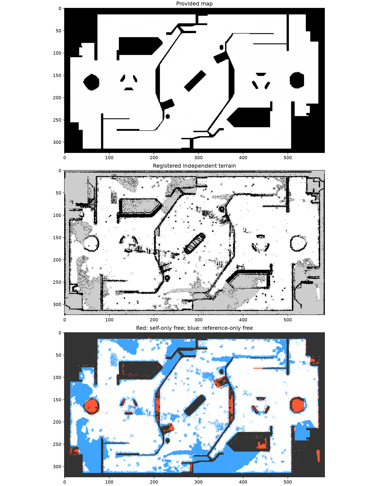
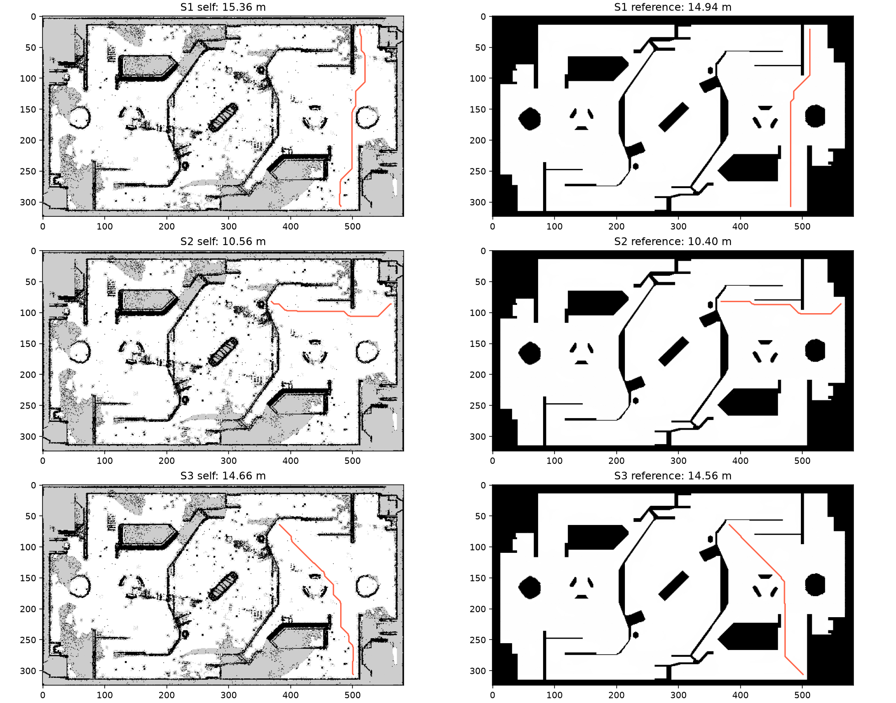
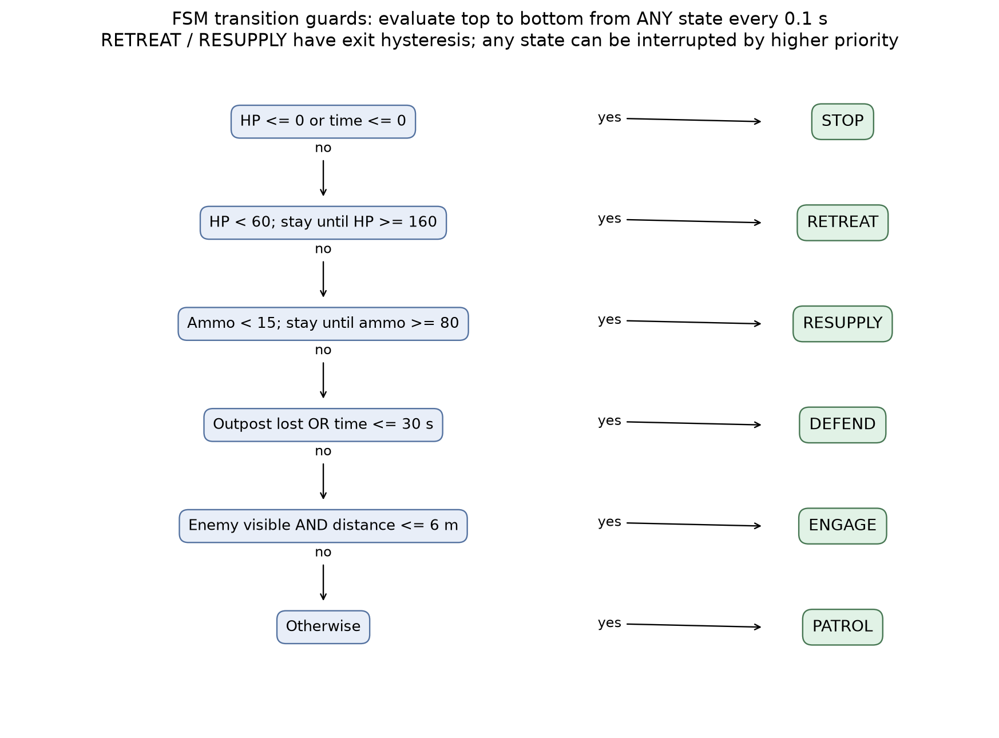
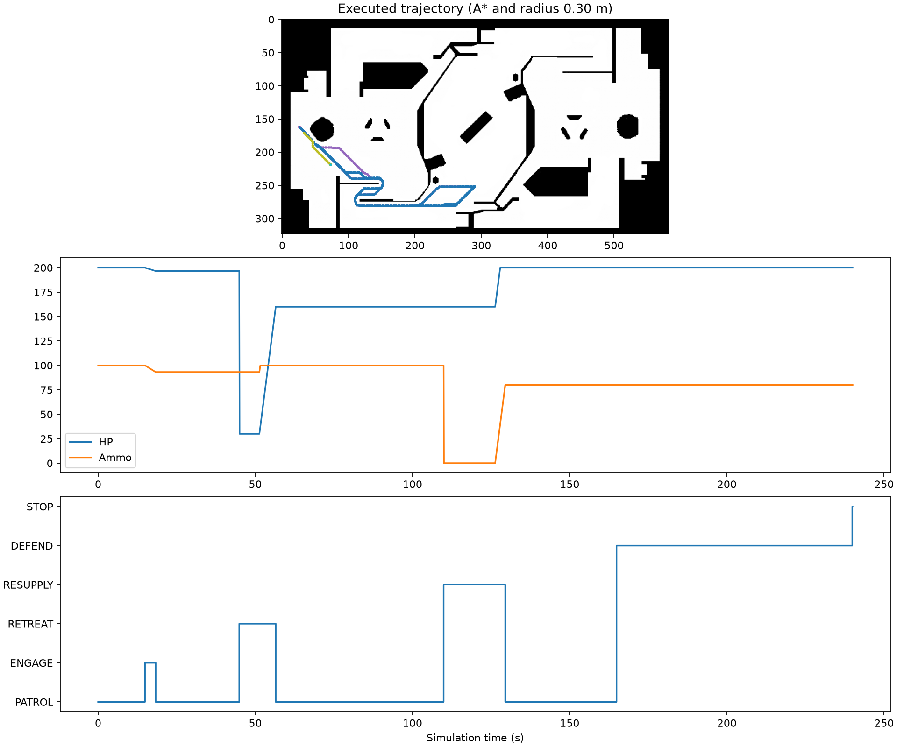

# B 题发挥部分：实现、结果与验证

> 本文件保留上一版实验记录。后续发现旧自建图灰度 205 会被 `free_thresh=0.25` 当作空闲，旧检查日志不能证明未知区被阻挡。代码已修正为 128；当前地图、原题五组通过结果及有效验证见 [优化报告](OPTIMIZATION_REPORT.md)。决策仿真使用题目给定二值地图，不受该错误影响。

本次补齐六项发挥要求对应的程序和实验材料。结果保留失败与不确定性：自建地图仍较保守，不能复现给定地图上全部可达查询；没有人工地形标签或实车数据，局部规则测试不能等同于全场地正确率。

## 完成情况

| 发挥要求 | 实现与证据 |
|---|---|
| 坡道与台阶区分 | 局部支撑面、5×5 平面坡度、12 cm 高度突变；合成坡道/台阶测试及实际地形图 |
| 异常物体识别处理 | 识别超高外围外壳，单独导出并从导航点云排除；保留低墙与原始数据，成因注明推断 |
| 地图旋转对正 | 原有地面/墙面法向对正，加 SE(2) 米制地图配准 |
| 搜索过程与算法对比 | 原五组搜索顺序图与指标表，新增逐步扩展视频 |
| 自建地图规划对比 | 原七组不改端点复查；另设三组共同安全端点，双地图、双算法共十二条路径通过检查 |
| 决策逻辑与二维仿真 | 六状态、五类输入、迟滞与安全优先级；240 s 仿真、状态图、日志与视频 |

## 复现

在项目根目录执行，原基础结果须已存在：

```powershell
.\.venv\Scripts\python.exe -m pip install -r qB_sentry/requirements.txt
.\.venv\Scripts\python.exe qB_sentry/test_planner.py
.\.venv\Scripts\python.exe qB_sentry/test_advanced.py
.\.venv\Scripts\python.exe qB_sentry/terrain_advanced.py
.\.venv\Scripts\python.exe qB_sentry/register_map.py
.\.venv\Scripts\python.exe qB_sentry/compare_maps.py
.\.venv\Scripts\python.exe qB_sentry/decision_sim.py
.\.venv\Scripts\python.exe qB_sentry/visualize_advanced.py
```

从头运行时，先执行 `build_map.py` 与 `run_planning.py`。新增 SciPy 用于邻域运算、最近邻和刚性配准优化；A*、Dijkstra 仍使用自己的 `heapq` 实现，没有调用路径规划库。全部新结果在 `results/advanced/` 和 `results/decision/`，基础输出保留。

## 1. 地形与缺失观测

从每格最低点构造支撑面，保留 −0.12～1.2 m 范围。局部缺采样只有同时满足以下条件才插值：7×7 邻域闭合、至少 12 个有效格、距最近有效样本不超过 0.15 m、邻域高度范围不超过 0.10 m。插值使用最近有效高度，插值格单独存入 `terrain.npz`。大块未知、边界外及高度不连续的区域不补齐。

以局部支撑面判断 0.12～0.65 m 高度范围的障碍证据；邻接有效格高度差大于 0.12 m 标为台阶边缘；局部平面拟合估计坡度。最大坡度 30°、最大支撑高度 1.2 m 为工程假设，非题目提供的实车参数。连续坡道与同样总高度的突变台阶因此可区别处理。

本次插值 29,483 格，可通行 105,641 格，台阶边缘 12,346 格；坡度在 3°～30° 的可通行候选 16,327 格。候选数量不等于人工确认的坡道数量，表面噪声和拟合误差也可能进入该范围。




合成测试检查 11.31° 连续斜面可通行、30 cm 突变边缘不可通行；10 cm 台阶另作可视化参照。该 10 cm 台阶虽然没有触发 12 cm 边缘判据，局部平面拟合的等效坡度仍超过 30°，所以当前保守规则也将其附近阻塞；这说明模型还不能精确描述底盘越过小台阶的运动能力。实际场地还可能因稀疏点、遮挡和多层投影被保守阻塞。不能用参考图里的空闲区域直接覆盖自建地图，也不能通过减小机器人半径来让查询通过。

## 2. 异常外围物体

调平后最高点约 18.68 m。超过 3 m 的点有 645,110 个，其中 644,635 个（99.926%）距稳健外边界不超过 0.25 m，形成垂直外围外壳。其高度和集中在边界的几何形态与正常导航关注的场内设施不同，结合题目说明“仿真点云”，推测来自仿真模型的封闭围场几何，而非随机离群噪声。静态合并点云无法证明其具体生成过程，也不能据此确认其他物体是否动态。

处理规则为“z>3 m 且距外边界≤0.25 m”：排除高处外壳，低处墙体仍保留。分别保存 `navigation_cloud.ply` 和 `excluded_upper_shell.ply`，原始点云及此前调平点云不修改。这是导航用途的裁剪，不声称物理场景中这些点绝对不存在；3 m 阈值有明确用途假设。

这些高点本来已超出底盘碰撞高度范围，因此排除它们主要降低点云冗余，不应被描述为使地面通道凭空变宽。密集、连贯外壳也不能仅靠统计离群滤波去除。



## 3. 坐标配准与地图对正

保留米制尺度，估计二维旋转和平移，不做缩放、镜像或按查询调整。自建图提取连贯障碍轮廓，参考图提取空闲边界；使用截断双向最近邻距离评价。在已经墙面对正的基础上，分别搜索约 +90°、−90° 两个方向，角度邻域 ±0.06 rad、平移邻域 ±1.2 m，固定随机种子。

较优变换近似为：

```text
x_reference = -y_aligned + 22.9700
y_reference =  x_aligned +  4.3600
```

完整矩阵、两个候选及指标在 [registration.json](results/advanced/registration.json)。旋转后采用最近邻重采样到参考图的世界坐标网格；超出自建图范围填未知，不复制参考图的占据信息。配准图 YAML 的 yaw=0，因此可直接使用题目检查器。

| 指标 | 结果 |
|---|---:|
| 选定旋转 | 约 +90° |
| 选定候选截断双向距离目标值 | 0.32843 m |
| 另一个候选目标值 | 0.33290 m |
| 单向特征最近邻距离中位数 | 0.150 m |
| 单向特征距参考轮廓≤约 0.15 m 比例 | 52.56% |
| 自建已知格覆盖率 | 68.99% |
| 已知格上通行判断一致率 | 90.30% |
| 自建/参考空闲区域 IoU | 72.53% |

场地接近 180° 对称，两候选分数只差约 1.34%，因此朝向仍存在歧义风险。当前按几何分数选取，不能说已获得高置信度绝对定位。更可靠的消歧需要已知位置标志物或采集起点信息；残差也不是测绘精度。所有路径比较均以本次所选变换为条件。



## 4. 自建地图上的规划

原始七组端点保持不变，完整结果在 [comparison.csv](results/advanced/comparison.csv)。

| 查询 | 给定图 | 本次自建图 |
|---|---|---|
| 1 | 21.077 m | 起点、终点安全间距不足 |
| 2 | 27.493 m | 起点安全间距不足 |
| 3 | 50.832 m | 起点、终点安全间距不足 |
| 4 | 25.883 m | 起点安全间距不足 |
| 5 | 56.959 m | 终点安全间距不足 |
| 6 | 终点安全间距不足 | 起点、终点安全间距不足 |
| 7 | 终点越界 | 起点安全间距不足且终点越界 |

这不是搜索算法找不到已存在路径：这些案例在端点有效性检查时即被拒绝。点云局部缺失、保守地形边缘和约 15 cm 的轮廓差异，经 0.30 m 半径约束后影响通行。不能将结果伪装成与给定图一致。

为实际验证自建地图上的搜索，在其最大安全连通区域与参考图安全区域的交集中，按三个方向选取相距较远的端点，形成 **独立补充查询 S1～S3**。它们不是原题端点的替换，不用于声称原七组通过。端点与选择方式保存在 [supplemental_queries.json](results/advanced/supplemental_queries.json)。

| 补充查询 | 自建图路长 m | 给定图路长 m | 自建图 A* / Dijkstra 扩展次数 |
|---|---:|---:|---:|
| S1 | 15.356 | 14.942 | 4,748 / 20,779 |
| S2 | 10.561 | 10.396 | 4,384 / 17,434 |
| S3 | 14.665 | 14.565 | 6,247 / 20,635 |

每张图上 A* 和 Dijkstra 路长一致。三组×两地图×两算法共十二条路径均通过官方检查器，也通过完整线段密采样复查；CSV 与检查日志在 `results/advanced/supplemental/`。时长数据在 [supplemental_results.json](results/advanced/supplemental_results.json)，仍是本机单次计时。



原给定图 A*/Dijkstra 的逐步扩展回放见 [search_replay.mp4](results/advanced/search_replay.mp4)。两侧使用同一扩展预算展示，不以动画速度冒充程序运行耗时；已完成的一侧保留最终路径。

## 5. 决策状态机与二维仿真

采用优先级状态机。每 0.1 s 从最高优先级重新判断，因此低血等紧急条件可以打断巡逻或交战。状态如下：

| 优先级 | 状态 | 进入条件与动作 |
|---:|---|---|
| 1 | STOP | 血量≤0 或剩余时间≤0，停止 |
| 2 | RETREAT | 血量<60；前往补给点，保持该状态直到血量≥160 |
| 3 | RESUPPLY | 弹量<15；前往补给点，保持至弹量≥80 |
| 4 | DEFEND | 前哨站失守或剩余时间≤30 s；前往防守点 |
| 5 | ENGAGE | 敌方可见且距离≤6 m；在当前安全位置交战 |
| 6 | PATROL | 其他情况；沿两个巡逻点往返 |

迟滞避免资源在单一阈值附近反复切换。距离来自敌我二维位置；视线沿地图逐格采样，障碍后的敌方不触发交战。移动目标由手写 A* 规划，按 1.2 m/s 沿路径执行，不穿墙、不直接瞬移到目标；规划失败时停留并记录事件。



上图是从任意状态进入的转移判定链，按顺序选第一个满足条件的状态。可编辑矢量版见 [state_transition.svg](results/decision/state_transition.svg)。

### 仿真设定与实际发生的事件

场景使用给定地图，以隔离自建地图配准的不确定性。初始血量 200、弹量 100；补给点每秒恢复血量和弹量各 25；射击消耗弹量 2/s、敌方血量降低 30/s、我方受损 1/s。这些是用于验证逻辑的简化假设，不是官方赛制或弹道模型。

| 时刻 s | 事件/状态变化 |
|---:|---|
| 0.0 | 开始巡逻 |
| 15.0 | 注入一个有视线的敌方目标，进入交战 |
| 18.4 | 敌方已被击败，恢复巡逻 |
| 45.0 | 场景主动注入重伤，血量设为 30，进入撤退 |
| 56.6 | 返回补给并恢复到 160，恢复巡逻 |
| 110.0 | 场景主动将弹量置零，进入补给 |
| 129.6 | 弹量恢复到 80，恢复巡逻 |
| 165.0 | 前哨站失守，进入防守 |
| 240.0 | 时间结束，停止 |

伤害和弹量突变是明确的测试输入，记录在 `events.json`，不是假装由自然战斗模型产生。末期时间触发与前哨失守在完整场景中重叠，另有独立测试验证“前哨仍在但仅剩 15 s”也进入防守。

总计模拟 240 s，执行移动 186.15 m，经历 6 种状态及 9 次转移；2401 次位置/运动段检查未发现碰撞，无规划失败。资源补给后确实退出对应状态，仿真结束后停止。视频以 10 倍速度播放，约 24 s。

- [二维仿真视频](results/decision/simulation.mp4)
- [逐步位置、资源和状态记录](results/decision/trajectory.csv)
- [状态转移日志](results/decision/transitions.json)
- [仿真统计](results/decision/summary.json)



## 6. 必答问题补充与验证边界

有限状态机适合本题少量明确模式，优先级和迟滞便于检查。行为树更适合层次任务和可复用动作组合，但仍需处理优先级、条件抖动和动作失败。小型 LLM 可以把自然语言指令转成高层意图或辅助战术解释；延迟、输出不确定、幻觉和输入干扰使它不宜直接控制碰撞规避与实时射击，执行前应经过确定性的状态与安全约束。

验证包括原 5 项规划测试和新增 6 项测试：已知旋转平移恢复、连续坡面与台阶、有限孔洞补齐、遮挡/不可达目标、低血优先级和迟滞、五类决策输入。完整仿真另检查安全移动、六状态覆盖、敌方击败、撤退恢复、补给恢复。十二条补充路径逐条运行官方检查器，视频已导出。

当前局限：真实地形没有人工标注；外围外壳成因是几何推断；地图有近似对称歧义；原七组在自建图上仍不满足端点通行约束；仿真只有静态障碍和简化敌方行为，没有动态避障、实车动力学及完整比赛规则。以上不确定性不通过修改数据、移动端点或抹去障碍掩盖。
