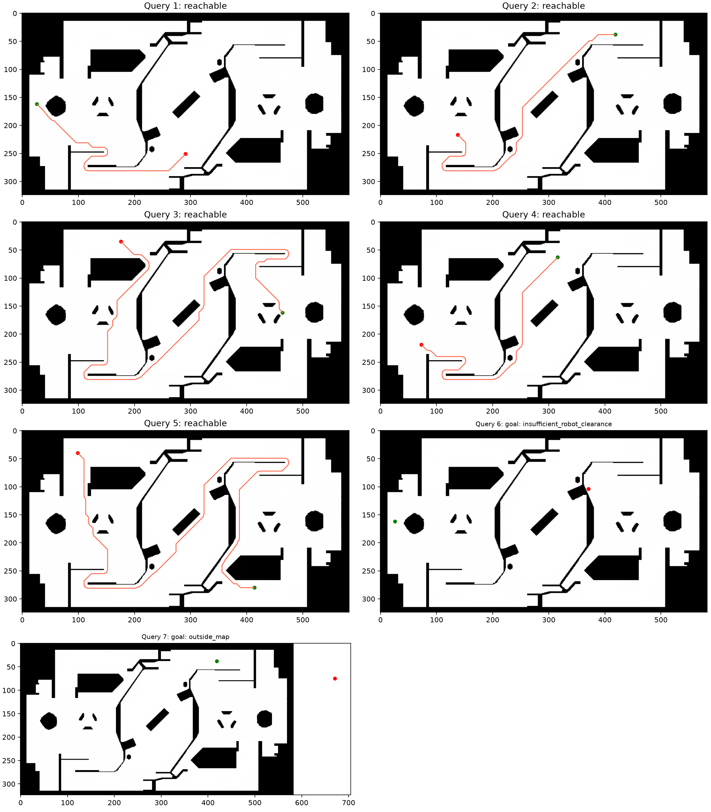
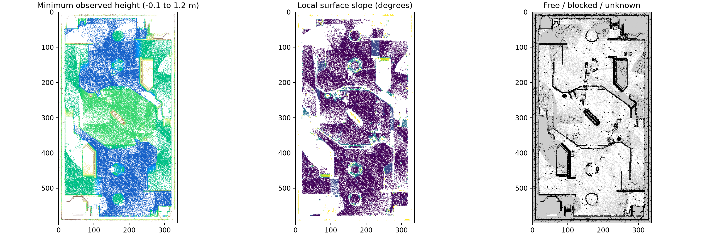

# B 题 环境建图与路径规划

**当前自建图版本：** [优化报告](OPTIMIZATION_REPORT.md)。原题前五组已在自建图上跑通，十条路径通过对应地图检查。旧版未知灰度 205 与阈值不匹配的问题已修复，当前使用 128；旧版自建图日志不再作为安全验证依据。

## 完成情况

已实现手写八邻域 A* 和 Dijkstra，在给定地图上运行全部七组查询。前五组可达，两算法路径均通过题目检查器；第六组终点不满足底盘半径，第七组终点越界。点云已完成降采样、离群点剔除、地面识别、调平、边界对正及 0.05 m 通行栅格生成。

发挥部分现已补充实现：自建地图配准、原七组与独立补充查询对比、外围异常外壳处理、搜索动画、六状态决策及二维仿真。详见 [发挥部分完整报告](ADVANCED_REPORT.md)。后续优化已使原题前五组在自建图上通过；原第六、七组仍不可达，交叉到给定图的边界差异和配准歧义另见优化报告。下面的点云统计描述初版；新版数据以发挥报告为准。A 方向报告见 `../qA_aim/README.md`。

## 运行

在仓库根目录：

```powershell
.\.venv\Scripts\python.exe -m pip install -r qB_sentry/requirements.txt
.\.venv\Scripts\python.exe qB_sentry/test_planner.py
.\.venv\Scripts\python.exe qB_sentry/run_planning.py
.\.venv\Scripts\python.exe qB_sentry/build_map.py
```

Open3D 0.20.0 已在当前 Python 3.13 环境成功安装，pip check 无冲突。

## 搜索算法与机器人约束

### 从你熟悉的 Dijkstra 理解本题

可以先跳过点云，看 `planner.py` 的搜索函数：Dijkstra 的堆优先级是 g，A* 改为 g+h；松弛操作、最优距离表、父节点回溯仍然相同。八邻域启发函数用 h=max(dx,dy)+(sqrt(2)−1)min(dx,dy)，对应没有障碍时的最短路。它不高估真实代价，所以标准 A* 保留最优性。

本题比 ACM 网格最短路多出的关键工作发生在建图和约束：机器人有 0.30 m 半径，不能只看中心点是否撞墙；图片行号向下，世界坐标 y 向上；未知区域不能直接当空地；斜移不能穿过两个障碍之间的角。先把这些条件正确转换成图，再运行熟悉的最短路算法。

建议阅读顺序：`test_planner.py` → `planner.py` → `run_planning.py` → `build_map.py`。建模时可把整套方案理解为“点云观测 → 地形特征 → 通行约束 → 图上的最短路”，每一步都有独立假设和验证指标。

将白色空闲区域视作图节点，障碍和未知格均不可通行。八邻域直移代价为 1，斜移为 sqrt(2)，最终乘 0.05 m。A* 使用 octile 启发函数，Dijkstra 启发函数为零；用 heapq、最小代价表和父节点回溯自行实现，未调用规划库。

在搜索前按 0.30 m 底盘半径膨胀，距离定义与题目检查器一致，按障碍格中心计算；图外补障碍边界。此离散碰撞模型不同于把每个障碍格完整正方形都算入实体的更保守模型。禁止斜向穿角；路径包括实际起终点和中间格心，段长不大于 0.15 m，并以不大于 0.01 m 的步距复查沿线安全格。

世界坐标到栅格时先减 origin，再逆转地图 yaw，然后除 resolution 向下取整；图像行方向与地图 y 方向相反。输出保留给定起终点，不将不可行点偷偷平移。

## 七组结果

| 查询 | 状态 | A* 路长 m | 扩展次数 | 搜索耗时 ms |
|---|---|---:|---:|---:|
| 1 | reachable | 21.077 | 29281 | 126.11 |
| 2 | reachable | 27.493 | 43484 | 203.65 |
| 3 | reachable | 50.832 | 81786 | 327.96 |
| 4 | reachable | 25.883 | 33506 | 168.44 |
| 5 | reachable | 56.959 | 71357 | 287.39 |
| 6 | goal: insufficient_robot_clearance | — | — | — |
| 7 | goal: outside_map | — | — | — |

第六组终点对应格到最近障碍格中心距离 0.25 m，小于 0.30 m；第七组目标 x=30 m，位于地图范围外。第六、七组没有伪造路径文件。

前五组 A* 路径位于本目录 `path1.csv` 至 `path5.csv`；两算法的分别输出与官方检查日志在 `results/astar/` 和 `results/dijkstra/`。程序同时核对原查询起终点、段长及采样后的线段，不只依赖官方检查器。



## 算法与启发函数对比

| 查询 | 算法 | 扩展次数 | 搜索耗时 ms | 路长 m |
|---|---|---:|---:|---:|
| 1 | astar | 29281 | 126.11 | 21.077 |
| 1 | dijkstra | 43090 | 160.74 | 21.077 |
| 1 | astar_manhattan_w1 | 25809 | 116.15 | 21.077 |
| 1 | astar_octile_w2 | 388879 | 1767.01 | 21.077 |
| 2 | astar | 43484 | 203.65 | 27.493 |
| 2 | dijkstra | 69896 | 268.29 | 27.493 |
| 2 | astar_manhattan_w1 | 33805 | 156.60 | 27.493 |
| 2 | astar_octile_w2 | 106903 | 492.13 | 27.493 |
| 3 | astar | 81786 | 327.96 | 50.832 |
| 3 | dijkstra | 100469 | 376.71 | 50.832 |
| 3 | astar_manhattan_w1 | 80415 | 332.19 | 50.832 |
| 3 | astar_octile_w2 | 277049 | 1235.87 | 50.832 |
| 4 | astar | 33506 | 168.44 | 25.883 |
| 4 | dijkstra | 76613 | 288.06 | 25.883 |
| 4 | astar_manhattan_w1 | 31421 | 145.60 | 25.883 |
| 4 | astar_octile_w2 | 42816 | 199.23 | 25.883 |
| 5 | astar | 71357 | 287.39 | 56.959 |
| 5 | dijkstra | 95491 | 346.44 | 56.959 |
| 5 | astar_manhattan_w1 | 68389 | 292.24 | 56.959 |
| 5 | astar_octile_w2 | 202077 | 927.83 | 56.959 |

耗时是当前机器单次运行的搜索时间，不含绘图和检查器，不能作为稳定性能基准。扩展次数统计出队并实际展开的事件，包含更优代价发现后的重新展开；不是去重后的格子数。

正常 octile A* 与 Dijkstra 路径代价已通过断言比较。八邻域中曼哈顿距离可能高估代价，乘 2 的启发函数也不再保持标准最优性保证。本次这几个可达查询仍得到相同路径长度，但这不是普遍最优性证明。

尤其加权启发函数在本图上没有更快，部分查询产生了大量重新展开，这是该实现保留更优 g 值重新入队机制的实际结果；不能预设“权重越大必定搜索越少”。搜索顺序图以颜色编码扩展次序，见 `results/search_query1.png` 等。

## 点云处理与地面识别

原始点数 2,116,092；0.05 m 体素降采样后 1,009,274；统计离群点剔除后 998,200。离群点过滤采用 20 邻点、2 倍标准差。

先连续拟合八个候选平面，结合雷达向前下方倾斜约 20°、距地面约 0.4 m 的安装先验筛选。前四个主要候选是相互成对的墙面，不能直接把首次 RANSAC 最大面当作地面。选定候选编号 4（从零计）的法向约为 (0.3747,0.0646,0.9249)，平面偏置约 0.4165 m。

构造旋转使地面法向指向 +Z，并把选定平面置于 Z=0；将主要墙面法向投影作为水平轴，使场地边界对正。地面内点残差 RMS 约 6.96 mm。该残差是拟合一致性，不等于地图绝对精度。


## 通行栅格生成

每格统计点数、最低高度、最高高度；邻域估计局部支撑面。使用局部表面而非全局固定 z 阈值判断障碍：相对支撑面 0.12～0.65 m 的点作为阻挡证据，邻接表面突变超过 0.12 m 标为台阶边缘，再拟合局部平面估计坡度。

当前最大支撑面高度 1.2 m、最大坡度 30° 是可调工程假设，题目没有给出准确最大爬坡角；不能将它们当作哨兵实车规格。没有观测的格保留未知，不从一张最终点云中虚构射线经过的空闲空间。

生成 338×599 栅格，分辨率 0.05 m；自由格 76,733，阻挡格 29,086，未知格 96,643。保存 `results/pointcloud/generated_map.pgm` 与 YAML，变换矩阵和参数见 `report.json`；`terrain.npz` 保存高度、坡度和台阶边缘。



连续坡面与离散台阶已在规则上区分，但没有人工标签或实车验证，不能宣称所有坡道均已正确识别。稀疏观测、场地中的未知区、多层投影和遮挡会造成保守阻塞。初版仅记录自建坐标系；后续配准和查询对比见 [发挥报告](ADVANCED_REPORT.md)，使用配准后地图才能直接应用原查询世界坐标。

## 必答问题

1. **首次拟合是否地面？** 不是。本次最大候选接近墙面，地面由法向、相对雷达高度和空间形态综合判断。
2. **为何不能按全局高度阈值判障碍？** 高地与坡道本身可作为支撑面，全局高度高不代表不可通行；应判断局部坡度、相邻高度突变、净空和可达连接。
3. **首次检查是否通过？** 第一版输出的第 1、2、4、5 组路径通过检查，但额外半格膨胀将第 3 组误判为起点净空不足。核对其最近障碍中心距离为约 0.320 m 后改为题面检查器定义，第 3 组也成功并通过检查。不是用修改检查器规避问题。
4. **曼哈顿或两倍启发函数？** 如对比表所示；本场景路长未变，但最优性不再普遍保证，加权版重新展开次数显著增加。
5. **YAML 参数含义？** origin 是地图栅格原点在世界坐标系中的位置与朝向；resolution 是每格米数；occupied_thresh 是占据概率判定阈值；free_thresh 是空闲概率判定阈值；中间状态为未知。本题碰撞检查把未知也视作不可通行。
6. **状态机、行为树与 LLM？** 状态机适合有限且明确的状态，行为树便于组合层次任务；LLM 可辅助高层意图解释，但延迟、输出不确定性和可验证性限制使其不适合直接替代实时安全控制。后续已实现六状态决策仿真，见 [发挥报告](ADVANCED_REPORT.md)。

## 验证与局限

已运行坐标旋转往返、已知最短路、斜向穿角、起终同格、底盘净空约定测试。前五组两算法共十条路径官方检查通过，最短路代价一致，保留查询原坐标。初版保留全部密集物体；后续基于外围高度和空间分布对高处外壳作可追溯导航裁剪，原始数据仍保留。自建地图的保守性、异常成因推断与配准不确定性详见发挥报告。

## 双地图碰撞与配准容错（最新）
详见 [ROBUST_BOUNDARIES_REPORT.md](ROBUST_BOUNDARIES_REPORT.md)。新结果在 results/robust/：原题前 5 组同时通过给定图、自建图与融合图检查。第 3 组固定起点在 27 种配准扰动中仅有 18 种有效，报告保留这一限制。此版本使用明确标注的双地图融合约束，独立建图结果仍在 results/optimized/。
