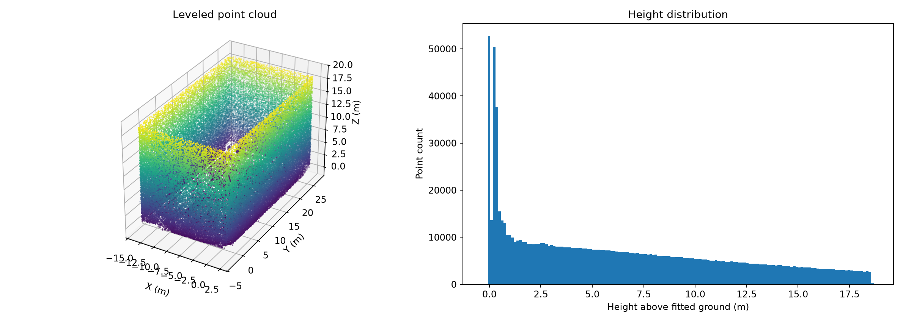
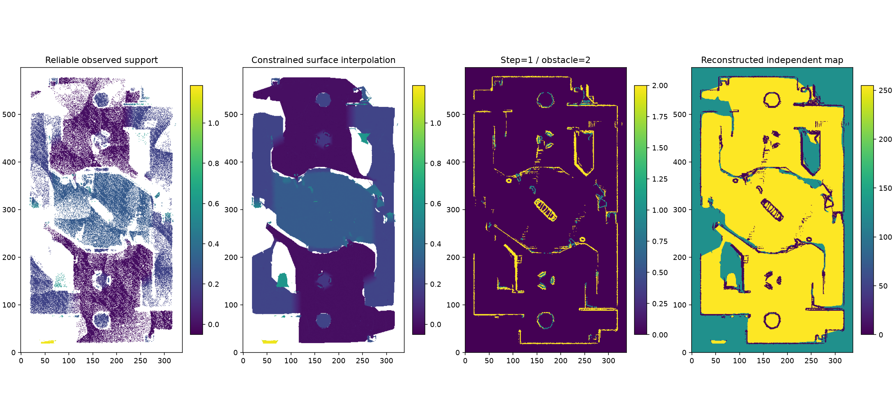
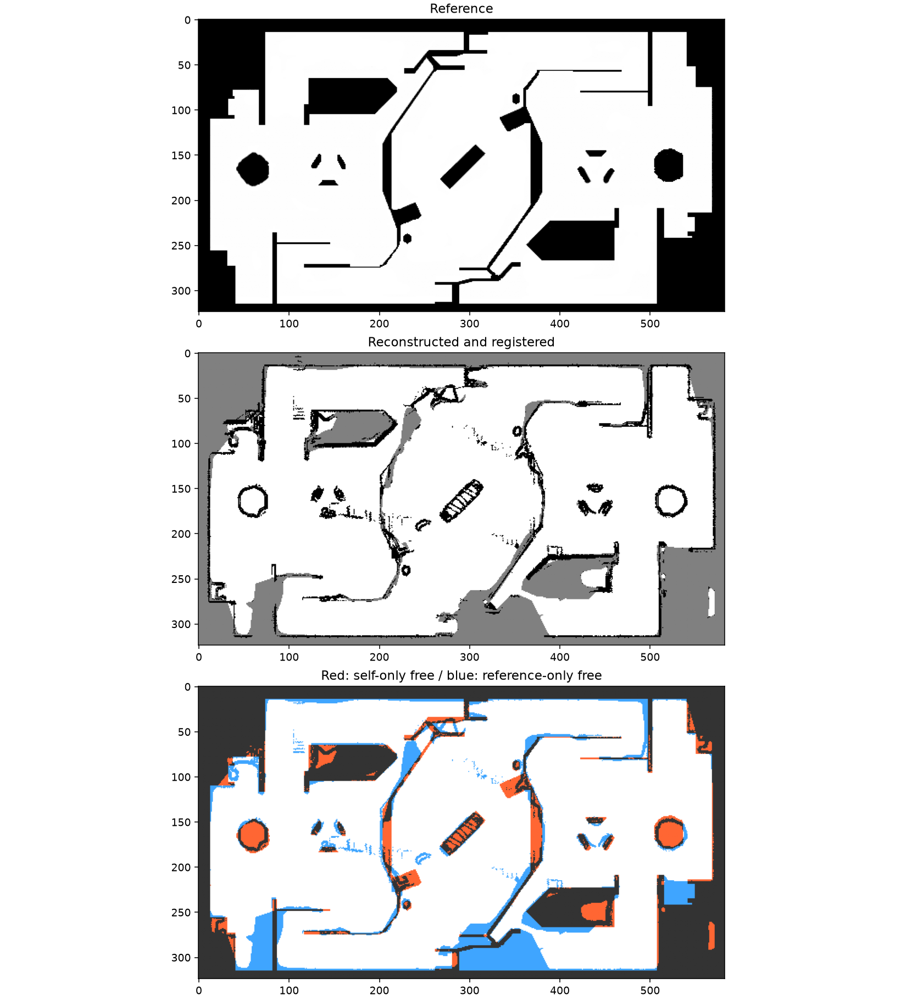
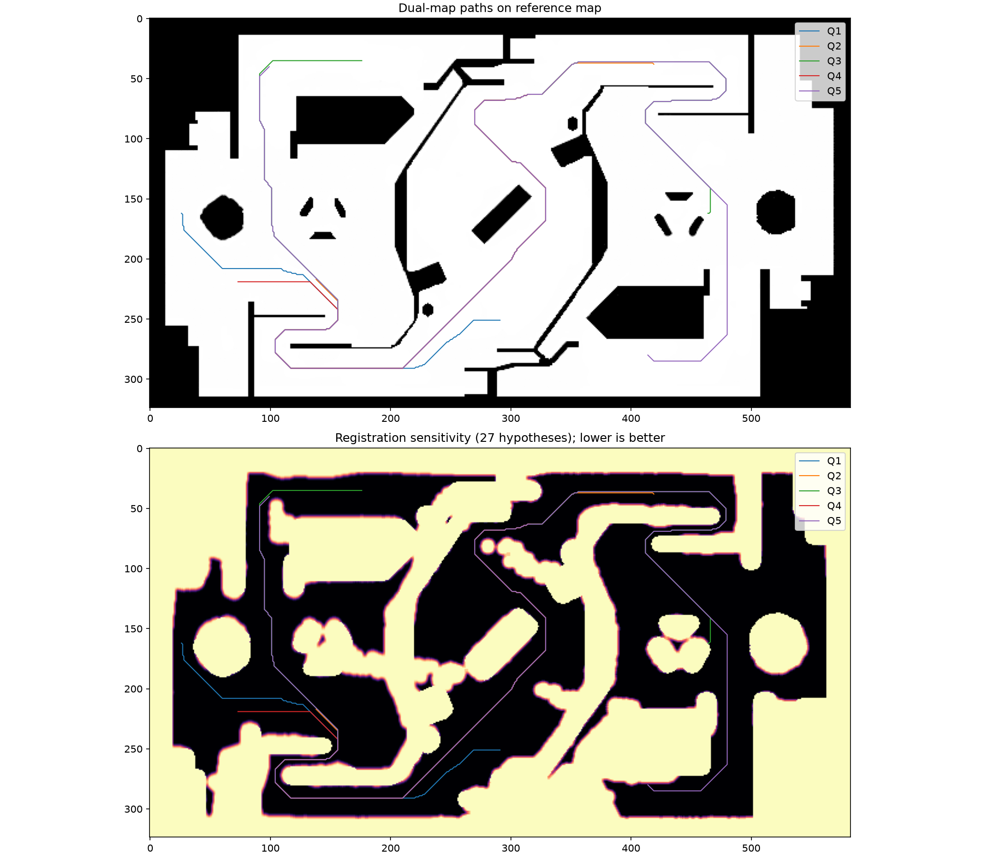
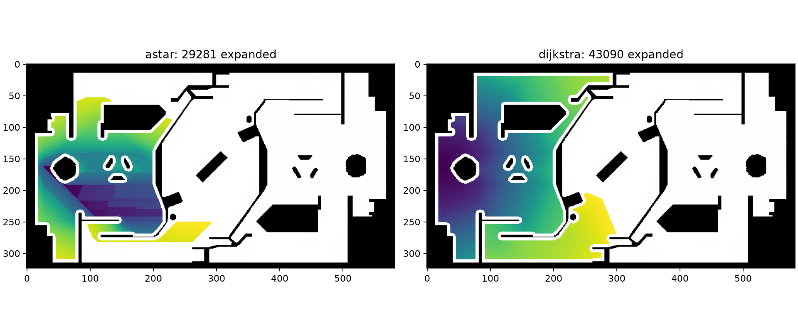

# B 题最终答题报告：环境建图与路径规划

实验日期：2026-10-18。本文汇总已保存结果，区分独立建图与参考图融合；个人信息由提交者填写。运行方法见 [RUN_GUIDE.md](RUN_GUIDE.md)，源码讲解见 [DEFENSE_GUIDE.md](DEFENSE_GUIDE.md)。

## 1. 完成情况

| 考核项目 | 实现与提交证据 | 验证边界 |
|---|---|---|
| 点云预处理、地面识别与调平 | build_map.py；pointcloud_overview.png、report.json | 地面选择结合安装先验；拟合残差不是绝对测绘精度 |
| 0.05 m 通行栅格 | reconstruct_map.py；optimized/terrain_map.pgm/yaml | 局部支撑面及有约束插值，未知保持阻挡 |
| 手写 A*/Dijkstra、7 组查询 | planner.py、run_planning.py；path1～5.csv、summary.csv | 第 6、7 组按原原因无法到达 |
| 坡道、台阶、高地边缘 | 局部坡度、12 cm 突变、短台阶规则及单元测试 | 30° 坡度上限为假设，未做全场地人工标注 |
| 异常物体处理 | terrain_advanced.py；anomaly_before_after.png | 高处外围外壳做导航裁剪，成因是推断 |
| 对正与配准 | 地面/墙面法向；refine_registration.py | 近似 180° 对称仍存在朝向歧义 |
| 搜索可视化与比较 | summary.csv、search_query*.png、search_replay.mp4 | 耗时为单机单次记录 |
| 自建地图规划 | optimized/ 两算法及验证文件 | 前五组自建图通过，原自建路线跨图失败如实保留 |
| 决策与二维仿真 | decision_sim.py；decision/ 视频、状态图、日志 | 六状态、五类输入，简化静态场景 |
| 新增双地图边界与容错优化 | robust_boundaries.py；robust/ 地图及路径 | 名义三图通过；第 3 组不是全扰动安全 |

## 2. 数据、约束与算法

输入为题目仿真点云、ROS 栅格图和七组世界坐标查询。机器人按半径 0.30 m 的圆处理，分辨率 0.05 m，路径点间距不超过 0.15 m。原始 queries.json、原题检查器、端点与半径均未修改，验证文件保留 SHA256。

规划使用八邻域网格。先按地图阈值区分空闲、占据、未知，计算到不可通行格中心的距离并按半径限制可行区域。边界外按障碍处理；斜移时两侧正交格都必须可行，防止穿角。距离约定与官方检查器一致；额外逐段以不大于 0.01 m 间隔采样，不仅检查输出顶点。

世界坐标与栅格坐标转换显式处理 origin、resolution、yaw，以及图片 y 向下、世界 y 向上的差别。输出路径始末使用原始查询坐标，中间使用格中心，不以最近可行格替换端点。

手写最短路使用 heapq、距离表和父节点。Dijkstra 堆优先级为 g；标准 A* 为 g+h，h=max(dx,dy)+(√2−1)min(dx,dy)，对应八邻域无障碍距离下界。更优 g 出现时允许重新入队，跳过过期队列项；回溯父节点得到路径。未调用现成路径规划库。堆实现的标准复杂度可按 O((V+E)log V) 理解，八邻域 E=O(V)；非一致或放大启发式引起的重新展开另计，不能保证实际更快。

## 3. 点云与独立地图

原始点数 2,116,092，0.05 m 体素降采样后 1,009,274，20 邻点、2 倍标准差统计过滤后 998,200。连续 RANSAC 得到八个平面候选，前四个主要是墙；结合约 20° 雷达倾角、约 0.4 m 安装高度，选择第 4 号候选（零起算）作为地面。法向约 (0.3747,0.0646,0.9249)，偏置约 0.4165 m。旋转法向至 +Z、平移地面至 Z=0，再利用墙面投影对正水平轴。地面内点 RMS 约 6.96 mm，仅代表拟合一致性。

调平后超过 3 m 的 645,110 点中，99.926% 集中在距外围边界 0.25 m 内，推测为仿真围场外壳。只按明确规则裁剪导航用途的高处外围部分，保留低墙和原始数据；无法由静态点云确认物体的生成过程或动态属性。它们本来不在底盘碰撞高度范围，不能说删除高点使地面通道变宽。

最新建图选取 −0.15～2 m 点云，利用 20 邻域协方差、平面残差、法向和邻域尺度筛选可靠支撑面，每格用支持点的中位高度。97,743 个可靠点覆盖 75,974 个直接观测格。一般三角插值限制最大边 1.2 m、顶点高度差≤0.12 m；对约 0、0.2、0.3 m 的独立高度层补齐缺采样，三角最大边 2.5 m、距最近同层观测≤0.8 m，仅填缺失且无层间冲突的格，不覆盖已有高表面或向凸包外外推。

局部支撑面以上 0.12～0.65 m 的可靠非水平表面提供障碍证据；邻格突变超过 12 cm 标为边缘，连续坡面按局部平面坡度判定。对局部范围不超过 12 cm 的小台阶，不再仅因平面拟合产生大等效坡度而阻塞。最大坡度 30°、支持距离等为工程假设。最终可通行 129,413 格、未知 59,920 格；插值 61,920 格中分层补充 12,513 格。插值不是实际观测，不能当作空洞真值。

重要纠错：旧代码用灰度 205 表示未知，但占据概率 (255−205)/255≈0.196，小于 free_thresh=0.25，实际被当成空闲。现在改为 128（约 0.498），并增加回归测试。旧 advanced 地图日志只作过程记录，不能证明未知区正确阻挡。

随机隐藏 3000 个实测格后，恢复 2984 个，绝对误差中位数 2.21 mm、95% 分位数 9.77 mm、RMSE 20.30 mm。较大的 RMSE 表明存在较大误差样本。删点实验不能证明本来不可见区域的准确性。将层内最大支持距离从 0.8 m 缩至 0.5 m 时第 5 组不再可达，说明其结果依赖有界平面补齐假设。

## 4. 米制配准与剩余不确定性

建图模块不读取参考栅格和查询。配准模块读取参考图边界，使用稳定竖直结构、截断双向最近邻距离与全图支撑重叠估计 SE(2)，不缩放、不镜像、不以端点通过率调参。6,708 个源特征分训练/留出，空间重叠按 16×16 交错块划分训练/留出。两个近对称朝向都参与比较。

当前旋转 89.99284°，平移 (22.97013,4.35900) m；近似变换为 x_ref=−y_aligned+22.97013，y_ref=x_aligned+4.35900。重采样后的 YAML yaw=0，以兼容题目检查器。

| 指标 | 当前结果 |
|---|---:|
| 自建/参考空闲 IoU | 85.51% |
| 训练/留出空间块 IoU | 85.72% / 85.30% |
| 已知格通行一致率 | 91.91% |
| 自建已知覆盖率 | 75.46% |
| 结构留出点到最近参考轮廓距离中位数 | 约 0.199 m |

两个朝向接近，orientation_ambiguous=true，绝对朝向仍需不对称标志物或已知初始位姿确认。高 IoU 不等于局部边界精准，也不代表绝对定位误差小于 5 cm。最新容错优化保留上述变换，没有宣称进一步降低配准残差。

## 5. 七组查询与最终结果

| 组号 | 给定图基本题路长 m | 独立自建图路长 m | 最新双地图容错路线 m | 结论 |
|---|---:|---:|---:|---|
| 1 | 21.077 | 20.548 | 22.902 | 可达 |
| 2 | 27.493 | 31.178 | 34.028 | 可达 |
| 3 | 50.832 | 54.933 | 60.990 | 名义可达，扰动限制见下一节 |
| 4 | 25.883 | 28.103 | 31.323 | 可达 |
| 5 | 56.959 | 59.547 | 66.106 | 可达 |
| 6 | — | — | — | 原终点净空不足；给定图约 0.25 m，小于 0.30 m |
| 7 | — | — | — | 原终点 (30,3) 超出地图 |

基本题根目录 path1～5.csv 保持给定图标准 A* 输出，Dijkstra 位于 results/dijkstra/。两算法每组最短路代价相等，10 条路径通过给定图官方检查。自建图 10 条路径通过自建图检查，但交叉到给定图全部出现碰撞；局部低台阶可通行规则、缺采样及配准差异共同导致两图不一致。不能据此称参考图错误。

最新增加的融合图把任一图的占据/未知都保留为禁止区，重新按原半径规划，所以不是复制参考空闲区清障，也不是纯点云独立建图。名义共同安全区域仍连接前五组原端点。10 条新路径分别通过给定、自建、融合图检查，共 30 次通过，另通过密采样检查和端点/点距约束。新路线优化的是长度、净空、配准风险的复合目标，不能称为原几何距离最短路。

## 6. 最新配准容错与第 3 组限制

构造 dx、dy∈{−0.05,0,+0.05} m，角度增量∈{−0.1,0,+0.1}° 的 27 种组合，每种重新采样自建图、执行机器人膨胀并与给定图安全区相交。旋转包含源坐标系下的杠杆位移。风险 r 是 27 种情形不安全的比例；节点代价为 1+40r+2exp(−max(margin,0)/0.12)，margin 是名义图净空超过 0.30 m 的部分。边代价取两端均值乘长度，因此仍不低于几何长度，标准 octile 启发式仍是下界。A* 与 Dijkstra 的加权总代价已核对一致。

| 查询 | 最新固定路线整条通过的扰动数 |
|---|---:|
| 第 1、2、4、5 组 | 各 27/27 |
| 第 3 组 | 18/27 |

**第 3 组不是“全部容错成功”。** 固定起点 (19.65,−1.36) 本身只有 18/27 种扰动满足净空；另外 9 种从出发时已经无效，任何仅改变后续路线的办法都不能修复起点。最新路径在约 1 cm 内部采样下，所有扰动均安全的采样点比例从 58.15% 升为 99.956%，余下风险集中于起点附近约 2 cm 的采样段。旧指标同时包含给定图碰撞，所以提升不能全归因于配准精度。

这里不删去起点、不降低半径、不强行清除障碍，也不把失败情形计为通过。风险是软代价，名义碰撞是硬约束。27 个样本只是在选定朝向周围的离散敏感性测试，不保证中间所有变换连续安全，更不覆盖 180° 朝向歧义或真实误差分布。0.199 m 的结构残差不是扰动概率模型；±5 cm 只是测试幅度。

若部署实车，应增加可靠定位/标志物确认边界与起点是否安全；起点无法通过保守检查时停止并重新定位，而不是沿报告路线强行启动。报告路径是静态地图实验结果，未做实车验证。

## 7. 搜索比较与决策仿真

下表是保存的给定图标准搜索记录，耗时只含搜索，不含绘图与检查：

| 组号 | A* 扩展次数 | Dijkstra 扩展次数 | A* ms | Dijkstra ms |
|---|---:|---:|---:|---:|
| 1 | 29281 | 43090 | 126.11 | 160.74 |
| 2 | 43484 | 69896 | 203.65 | 268.29 |
| 3 | 81786 | 100469 | 327.96 | 376.71 |
| 4 | 33506 | 76613 | 168.44 | 288.06 |
| 5 | 71357 | 95491 | 287.39 | 346.44 |

扩展次数包括重新展开，不是不同节点数量。八邻域用曼哈顿或放大启发式可能高估，失去标准最优性保证。本数据路长碰巧仍相同；两倍 octile 在第 1 组扩展 388,879 次、耗时 1767.01 ms，比普通 A* 更慢，原因是重开机制和不良展开顺序，不能泛化为加权搜索必然更差或更好。

决策采用优先级状态机：STOP（血量≤0/时间到）、RETREAT（血量<60，恢复至160）、RESUPPLY（弹量<15，恢复至80）、DEFEND（前哨失守/剩余≤30 s）、ENGAGE（可见敌方在6 m内）、PATROL。每 0.1 s 重判，资源迟滞抑制抖动；敌方位置影响距离和视线判断；移动由手写 A* 规划。

仿真明确注入 15 s 敌方、45 s 重伤、110 s 弹尽、165 s 前哨失守。240 s、1.2 m/s 的简化场景覆盖六状态和九次切换，移动 186.15 m；2401 次运动/位置检查零碰撞，无规划失败。伤害注入不是自然战斗结果，静态场景不验证动态避障能力。仿真使用给定地图，与自建定位误差实验分开。

[仿真视频](results/decision/simulation.mp4) · [状态与资源曲线](results/decision/simulation_summary.png) · [搜索回放](results/advanced/search_replay.mp4)

## 8. 六个必答问题

1. **首次平面拟合是否得到地面？** 不是，最大面可能是墙。本例前四个主要候选为墙，结合法向、安装高度和倾角筛选地面，不能把 RANSAC 最大内点数等同地面。
2. **为何不能只按高度判断障碍？** 坡道与高地本身是有效支撑，绝对高度高不等于不能走。需要局部支撑高度、坡度、相邻突变和底盘相对净空；多层结构的二维投影仍有局限。
3. **首次检查是否通过，如何改进？** 基本题早期第 1、2、4、5 组通过，第 3 组因额外半格膨胀被误判起点无效；按检查器的障碍格中心距离约定修正后通过。随后独立建图暴露未知灰度错误并修复；自建路线跨图仍碰撞，最终用明确标注的融合安全约束和风险代价解决名义跨图碰撞。全程未改检查器、端点和半径。
4. **曼哈顿/两倍启发式的变化？** 八邻域中曼哈顿不是可采纳下界，乘2也可能高估，最优性不再保证。本例路长相同仅是实验观察，重开节点导致加权版部分查询更慢。最新风险边代价与“把启发函数乘2”是不同设计。
5. **YAML 参数含义？** origin 是栅格原点的世界位置及 yaw；resolution 是米/格；occupied_thresh、free_thresh 是占据概率阈值，中间为未知。negate=0 时概率 (255−gray)/255，未知也不通行。图像行号与世界 y 方向相反，非零 yaw 需旋转变换；题目检查器对 yaw 支持有限，因此导出图对齐到 yaw=0。
6. **状态机、行为树、小型 LLM？** 状态机适合少量明确状态，便于检查优先级；行为树适合层级任务与可复用动作，但同样要处理失败、抖动和抢占。小型 LLM 可辅助高层指令解释或战术建议，延迟、幻觉、不确定性和输入干扰使其不适合直接替代确定性的实时碰撞约束与控制。当前未接入 LLM 决策。

## 9. 验证、提交与学习总结

24 项单元测试覆盖最短路、坐标转换、斜向穿角、净空、地形重建、未知编码、配准、决策和风险代价。verify_submission.py 重新核查当前提交路径；完整证据见 [submission_verification.json](results/submission_verification.json)，最新优化的扰动明细见 [validation.json](results/robust/validation.json)。检查器输出截图见 [checker_results.png](results/checker_results.png)（基本题），新优化的文字日志位于 robust/ 两算法目录。

可总结的技术认识：本题的难点不仅是最短路搜索，更在于把点云证据、未知区、坐标系和机器人几何正确转换成图约束；单张图通过检查不代表另一张图或实车安全；模型插值、配准误差与固定起点必须分别分析。上述是项目技术总结，提交者应结合实际阅读、调试和独立实现经历，用本人语言补充学习体会，不将 AI 参与内容冒称独立完成。AI 辅助过程见 [ai_log.md](ai_log.md)。
