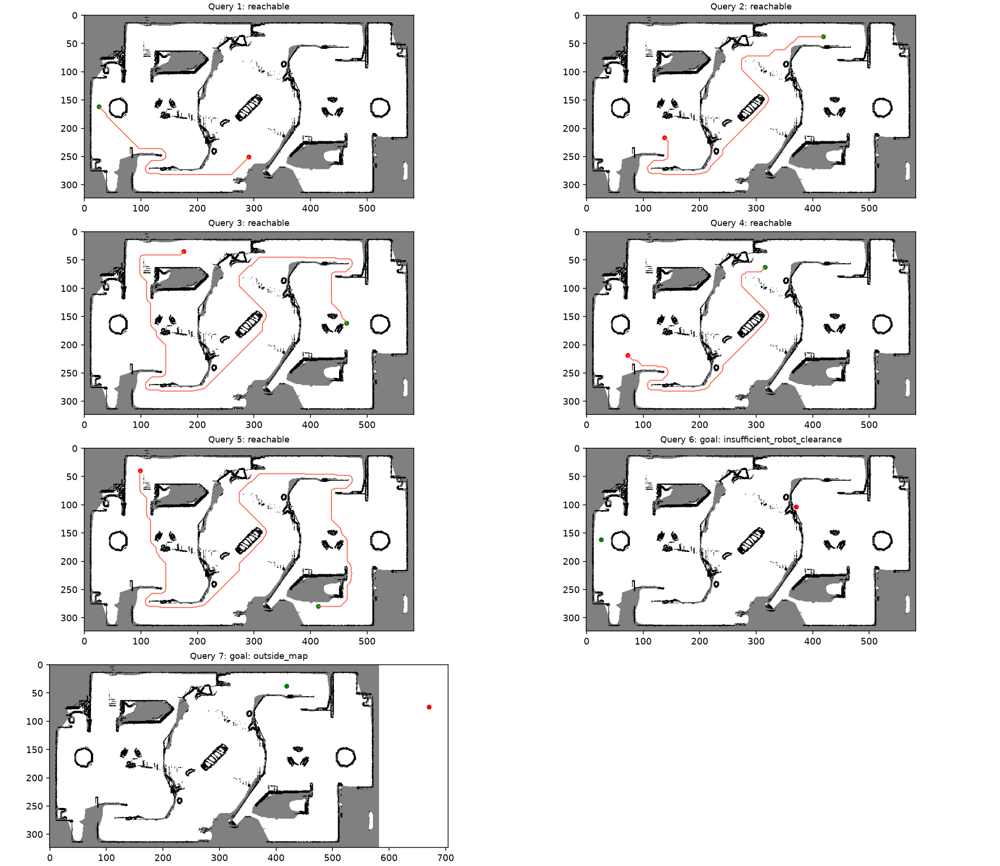
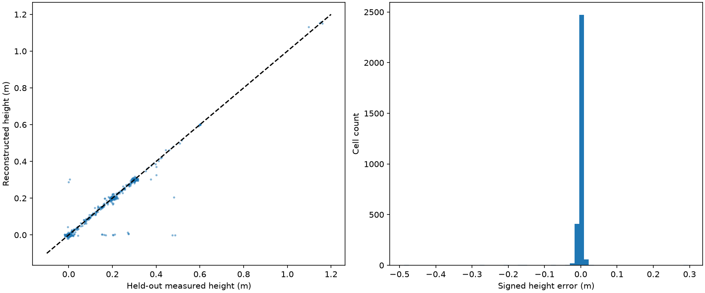
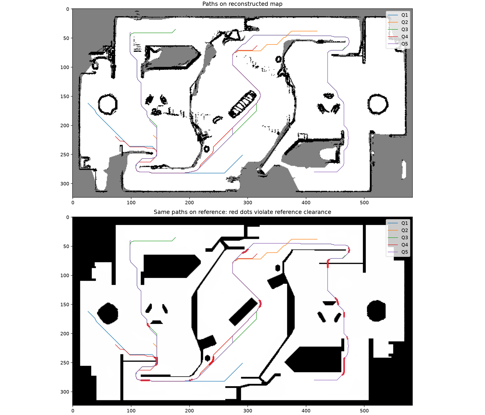

# 自建地图优化：原题前五组查询已跑通

## 当前结果

原题第 1～5 组查询现在均可在自建地图上到达。每组运行手写 A* 与 Dijkstra，十条路径均通过官方检查器（输入为自建图 YAML）和完整线段采样检查；同组两种算法路长一致。原题端点、0.30 m 底盘半径、0.15 m 最大路径点间距及检查器未修改。

| 原题查询 | 优化后自建图路长 m | 给定图原结果 m | 自建图结果 |
|---|---:|---:|---|
| 1 | 20.548 | 21.077 | 两算法通过 |
| 2 | 31.178 | 27.493 | 两算法通过 |
| 3 | 54.933 | 50.832 | 两算法通过 |
| 4 | 28.103 | 25.883 | 两算法通过 |
| 5 | 59.547 | 56.959 | 两算法通过 |
| 6 | — | — | 终点安全间距不足 |
| 7 | — | — | 终点越界 |

这不等于两张地图上的路径可互换。将这十条自建图路径放回给定地图检查，均出现边界碰撞。模型的低台阶判定、点云缺失和两图几何边界仍有差异；当前结果是“自建图上通过”，不能表述成“给定图上也通过”或“实车已验证”。原来给定图上通过的 `qB_sentry/path1.csv`～`path5.csv` 保留不动。



## 文件与运行

当前版本结果集中在 `results/optimized/`：

- [配准后的自建地图配置](results/optimized/registered_map.yaml)及同目录 `registered_map.pgm`。
- A* 路径：[path1](results/optimized/astar/path1.csv)、[path2](results/optimized/astar/path2.csv)、[path3](results/optimized/astar/path3.csv)、[path4](results/optimized/astar/path4.csv)、[path5](results/optimized/astar/path5.csv)。
- Dijkstra 路径位于 `results/optimized/dijkstra/`；两算法目录均有 `check_path*.txt`，以及 `cross_reference_check*.txt`。
- [查询汇总](results/optimized/comparison.csv)、[原端点和文件哈希验证](results/optimized/validation.json)、[重建和配准敏感性](results/optimized/audit.json)。

在项目根目录复现：

```powershell
.\.venv\Scripts\python.exe qB_sentry/reconstruct_map.py
.\.venv\Scripts\python.exe qB_sentry/refine_registration.py
.\.venv\Scripts\python.exe qB_sentry/evaluate_optimized.py
.\.venv\Scripts\python.exe qB_sentry/audit_reconstruction.py
.\.venv\Scripts\python.exe qB_sentry/test_reconstruction.py
```

重建读取此前的 `results/pointcloud/leveled.ply`。`point_geometry.npz` 是这一输入对应的几何缓存；若更换调平点云，应移走该缓存后再运行。当前工作没有更换输入。地图生成模块不读取参考栅格或查询；配准模块读取参考图估计坐标变换，但不读取查询，也不复制参考图的通行格。

## 1. 根因和重要纠错

第一类原因是缺采样：原方案每格取最低点，既易被少数异常点拉低，又在稀疏平地上留下许多未知格。某些孔洞与其他高度层相连，简单局部补孔也无法恢复它们。

第二类是地形解释：把 10 cm 小台阶附近的平面拟合坡度当作连续陡坡，造成过度阻塞；同一二维三角形中混入 0.2 m 地面和 0.6 m 结构顶部，也会让本来平坦的缺采样区无法插值。

第三类是配准的栅格边界偏差：第 3 组起点接近 0.30 m 安全边界，几厘米的坐标偏差就可能改变有效性。因此配准只能依据全局结构与重叠评价，不能专门移动地图让某个端点通过。

此外，本次发现并修复了此前报告遗漏的编码错误：灰度 205 对应占据概率 `(255−205)/255≈0.196`，在当前 `free_thresh=0.25` 下会被代码和题目检查器当作空闲，不能用它表示未知。现在统一使用 **128**，对应概率约 0.498，确实位于未知区间；新回归测试检查它不可通行。`build_map.py`、`terrain_advanced.py`、`register_map.py` 也已同步修正生成编码。

先前 `results/advanced/` 的历史栅格和检查日志保留用于追溯，不能再用其“检查通过”来证明未知区被正确阻挡。当前有效验证以 `results/optimized/` 为准。中间曾出现过依赖错误编码的五组通过结果，那一轮被否决；这里报告的是修正编码后重新生成、重新检查的结果。

## 2. 从可靠表面重建通行图

读取调平点云中 −0.15～2 m 高度的 285,715 个点，估计每点 20 个邻居的局部协方差。根据最小特征值对应的平面残差、法向方向、邻域半径和非退化程度选择可靠支撑面，而不是把所有点的最小高度都视为地面。

支撑面条件包括：局部残差标准差<0.018 m、20 邻域半径<0.45 m、法向与竖直方向夹角<30°。每格使用可靠支持点的中位高度，降低孤立低点的影响。获得 97,743 个可靠支持点，覆盖 75,974 个直接观测格。

重建分两层：

1. **一般表面三角插值**：在直接观测格之间作二维 Delaunay 三角剖分。三角形最大边≤1.2 m，顶点高度差≤0.12 m；只填三角形内部，不向凸包外延伸。高度重建后再区分小台阶与连续坡面。
2. **同高度层补充插值**：从高度直方图自动找到约 0、0.2、0.3 m 三个主层，分别有 35,497、19,397、15,633 个直接观测格。每层在 ±0.018 m 范围选支持点，至少需要 500 格；独立三角剖分允许最大边 2.5 m，但填入格距最近该层实测格不得超过 0.8 m。只补此前未知的位置，保留已有高地表面；不同高度层对同一空缺给出冲突预测时不填。

2.5 m 是针对大平面缺采样的模型尺度假设，不是雷达测量精度。最多 0.8 m 的支持距离意味着部分新空闲格来自平面模型推断，并非直接观测，单独标记在 `terrain.npz` 中。大范围空洞、层间冲突和凸包外仍保持未知。

碰撞证据独立计算：可靠非水平表面位于局部支撑面上方 0.12～0.65 m 时标障碍；超过 12 cm 的邻接高度突变保留为边缘。连续坡度上限仍为工程假设 30°；局部高度范围≤12 cm 的离散小台阶不再仅因等效坡度过大而自动阻塞。墙体不会被表面插值覆盖成可通行格。

最后共插值 61,920 格，其中分层补充 12,513 格；可通行 129,413 格，未知 59,920 格。相关参数和计数见 [reconstruction.json](results/optimized/reconstruction.json)。


## 3. 配准改进与仍存在的对称歧义

使用稳定竖直结构投影作为几何特征，排除外围仿真外壳。6,708 个特征分成 3,354 个训练点和 3,354 个留出点，分别比较约 ±90° 两个候选。几何对齐之后，在 ±0.1 m 范围内、以 0.025 m 步长微调平移，依据全图支撑区域重叠评分。

栅格重叠评价按 16×16 格的交错空间块分成训练与留出部分。两方向训练 IoU 相差不足一个百分点时，用独立结构距离评分决定，避免近似对称场地因极小重叠差异而轻易翻转方向。没有使用查询端点的可达性作为配准评分。

本次选定旋转约 **89.99284°**，平移 **(22.97013, 4.35900) m**。它与前一版 +90° 变换接近，主要变化来自更可靠的地图表面，而非大幅移动坐标系。

| 指标 | 结果 |
|---|---:|
| 自建/给定图空闲区域 IoU | 85.51%（上一版约 72.53%） |
| 训练空间块支撑 IoU | 85.72% |
| 留出空间块支撑 IoU | 85.30% |
| 已知格上的通行判断一致率 | 91.91% |
| 自建已知格覆盖率 | 75.46% |
| 竖直结构留出点的最近轮廓距离中位数 | 约 0.199 m |

两方向仍非常接近，`orientation_ambiguous=true`。这是几何近似对称导致的未解决限制；两方向下本次五组均可达，不能通过“哪一个能走通”消歧。需要已知起始位姿或不对称标志物才能确认绝对朝向。留出点来自同一地图，亦不等于独立测绘真值。


## 4. 验证与敏感性

**原题约束**：每条路径首尾坐标与原 JSON 逐一核对，误差容限 1e−12；路径点间距和整条线段按不超过 0.01 m 采样检查。查询文件和检查器 SHA-256 记录在 `validation.json`，半径保持 0.30 m。第 6、7 组继续按原原因拒绝，不为它们伪造路径。

**表面留出验证**：随机隐藏 3000 个实际观测格，重新重建，恢复 2984 个。高度误差中位绝对值 2.21 mm，95% 绝对误差 9.77 mm，RMSE 20.30 mm。RMSE 明显高于中位数，说明仍有少量较大误差，不能只报告中位数。这仅检查已观测区域删点后的恢复能力，不能证明原本不可见区域的真实高度。



**补充插值距离**：固定最终配准，最大支持距离为 0.5 m 时第 1～4 组可达、第 5 组间距不足；0.65 m 与 0.8 m 时五组均可达。第 5 组依赖有边界的平面缺采样推断，需要特别说明。

**配准扰动**：分别施加 x±0.05 m、y±0.05 m 四种平移。三种情况下五组仍可达；x+0.05 m 时第 3 组起点间距不足，其他四组仍可达。当前第 3 组对配准误差敏感，不适合声称有很大的安全余量。

新增 9 项回归测试覆盖未知编码、有限孔洞、不同高度层、小台阶、大台阶、墙体、宽空洞、重采样边界。与原规划 5 项和上一版 6 项测试合计 20 项。

## 5. 为什么交叉到给定图仍失败

给定图并非逐点地形真值，而是另一套二值通行边界。自建图按题目高度和局部表面规则建模，因此不强行令两张图逐像素一致。

例如自建路径经过约 (3.65, −5.66) m 时，给定图将其标为障碍；按本次变换，周围 0.2 m 范围的点云高度最高约 0.104 m，当前地形规则可能将其视为可跨越的小台阶。另一处约 (19.15, −0.5) m 的给定图障碍附近，点云样本主要接近地面，反映出采样、边界定义或配准差异。两例只能说明具体局部差别，不能据此证明所有交叉碰撞都是给定图不准确。

所有交叉失败日志均保留，图中红点标出给定图安全间距不满足的位置。没有从参考图复制障碍或空闲格来伪装独立建图，也没有为了通过检查而改半径、移动端点。



用于考核提交时：给定图规划继续使用原 `path1.csv`～`path5.csv`；自建图发挥实验使用 `results/optimized/astar/` 及对应 YAML，并附上差异和敏感性说明。当前完成的是可解释、可复现的自建图实验，尚不是经过实车验证的导航安全地图。
